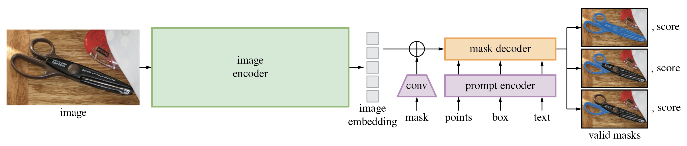
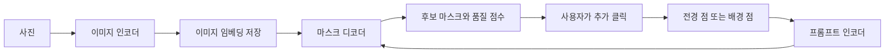

# Segment Anything: 클릭으로 지정하는 이미지 분할

## 1. Introduction

사진에서 가위만 남기고 배경을 지우려면 어디까지가 가위인지 알아야 한다. 물체 주변에 직사각형을 그리는 객체 탐지는 위치를 대략 알려 주지만, 가위 손잡이의 구멍이나 날의 윤곽까지 표현하지는 못한다. 이미지 분할(segmentation)은 이런 구분을 픽셀 단위로 수행한다. 결과는 대상에 속하는 픽셀을 표시한 마스크(mask)다. 흔히 말하는 ‘누끼 따기’를 떠올리면 출발하기 쉽다.

기존 분할 모델을 새로운 상황에 적용할 때는 해당 도메인의 정답 마스크를 모으고 모델을 학습시키는 비용이 컸다. SAM은 대규모 학습으로 얻은 분할 능력을 여러 작업에 재사용하려 한다. 사용자는 점이나 박스로 원하는 대상을 지정하고, 다른 모델도 자신의 출력을 같은 입력 형식으로 전달할 수 있다. 이 문제의식과 프로젝트의 세 축은 [Meta의 공식 소개](https://ai.meta.com/blog/segment-anything-foundation-model-image-segmentation/)에서 확인할 수 있다.

이를 위해 논문은 세 요소를 함께 설계한다. 무엇을 분할할지 지정하는 작업(task), 그 입력에 빠르게 반응하는 모델(model), 모델의 도움으로 학습 마스크를 늘리는 데이터 엔진(data engine)이다. 모델 구조만 보면 놓치기 쉬운 부분이 바로 마지막 요소다. 좋은 모델이 주석 작업을 돕고, 늘어난 데이터가 다시 모델을 개선한다.

## 2. Background

### 마스크와 프롬프트

크기가 $H\times W$인 이미지의 이진 마스크는 같은 위치의 픽셀이 대상에 포함되면 1, 아니면 0인 배열로 생각할 수 있다. 의미론적 분할은 픽셀의 종류를, 인스턴스 분할은 같은 종류의 개별 객체까지 구분한다. SAM의 기본 출력은 프롬프트에 대응하는 영역이다. 마스크 자체가 자동으로 ‘가위’라는 클래스 이름을 제공하는 것은 아니다.

여기서 프롬프트(prompt)는 텍스트로만 한정되지 않는다. ‘이 위치를 포함해 달라’는 전경 점, ‘이 위치는 제외해 달라’는 배경 점, 대상 주변의 박스, 이전에 얻은 마스크 모두 분할 대상을 지정하는 입력이다. 공개 구현의 [PromptEncoder](https://github.com/facebookresearch/segment-anything/blob/main/segment_anything/modeling/prompt_encoder.py)는 점·박스·마스크를 다룬다.

### 임베딩과 attention

임베딩(embedding)은 이미지나 입력 조건을 모델이 계산할 수 있는 벡터 표현으로 바꾼 것이다. 이미지에서는 위치별 특징이 모인 격자가 된다. 항상 원본보다 차원이 작아야 하는 것은 아니다.

Vision Transformer(ViT)는 이미지를 패치 단위 토큰으로 표현하고 토큰 사이의 관계를 계산한다. Self-attention은 같은 토큰 집합 내부의 관계를, cross-attention은 서로 다른 집합 사이의 관계를 계산한다. SAM에서는 ‘프롬프트가 이미지의 어느 특징을 참고할까?’와 ‘이미지 표현을 프롬프트에 맞게 어떻게 조정할까?’를 연결하는 데 cross-attention을 사용한다. 구체적인 모듈 구성은 [공식 구현](https://github.com/facebookresearch/segment-anything/blob/main/segment_anything/modeling/transformer.py)을 참고한다.

Zero-shot transfer는 대상 데이터셋이나 작업에 맞춰 추가 학습하지 않고 적용하는 설정이다. SAM이 아무 데이터 없이 학습했다는 의미는 아니다. 사전 학습된 모델에 어떤 프롬프트를 줄지 설계해 다른 작업에 연결한다.

## 3. Key Idea

SAM의 핵심은 분할 능력과 대상을 지정하는 방식을 분리해 재사용하는 것이다. ‘이 데이터셋의 클래스들을 모두 찾아라’보다, ‘이 이미지와 이 프롬프트에 맞는 유효한 영역을 반환하라’는 인터페이스에 가깝다.

예를 들어 가위 손잡이 위를 한 번 클릭했다고 하자. 사용자는 손잡이 구멍 주변을 원할 수도, 손잡이 전체를 원할 수도, 가위 전체를 원할 수도 있다. 한 점만으로 사용자 의도를 확정할 수 없으므로, 서로 다른 범위의 마스크 후보를 내고 추가 입력으로 좁혀 가는 편이 자연스럽다.

또한 같은 사진에서 클릭 위치만 바꿀 때마다 이미지를 처음부터 분석할 필요는 없다. 이미지 특징을 먼저 계산해 저장하고, 이후에는 프롬프트에 따라 마스크를 갱신한다. 공개 API도 [`set_image()`와 `predict()`](https://github.com/facebookresearch/segment-anything/blob/main/segment_anything/predictor.py)를 나누어 이 흐름을 구현한다.

## 4. Method

### 이미지에서 마스크까지

원논문 Figure 4와 같은 공식 구조 그림. [원본·이용 조건](../../assets/images/segment-anything/SOURCES.md). 그림의 `text`는 탐색적 실험까지 포함하며 기본 공개 모델의 텍스트 입력 기능을 뜻하지 않는다.

왼쪽의 큰 이미지 인코더는 사진을 한 번 처리한다. 아래의 프롬프트 인코더는 사용자의 입력을 표현한다. 둘을 받은 마스크 디코더가 오른쪽의 후보 마스크와 품질 점수를 만든다. 같은 사진에서는 이미지 인코더 결과를 재사용한다.

#### 1) Image encoder: 한 번 계산하는 이미지 표현

SAM은 MAE(Masked Autoencoder) 방식으로 사전 학습된 ViT를 사용한다. MAE는 가려진 이미지 내용을 복원하면서 시각 표현을 학습하는 방식이다. SAM의 이후 분할 학습은 정답 마스크를 사용하는 지도 학습이다.

공식 모델 구성에서는 긴 변을 1024로 조정한 뒤 정사각형으로 패딩하는 입력을 사용한다. 패치 크기는 16이며, 최종 이미지 임베딩은 $256\times64\times64$ 형태다. 앞의 256은 위치별 특징 채널, 뒤의 두 수는 공간 격자의 높이와 너비다. 모델 크기는 ViT-B/L/H로 제공한다. 이 설정은 [build_sam.py](https://github.com/facebookresearch/segment-anything/blob/main/segment_anything/build_sam.py)와 [입력 전처리](https://github.com/facebookresearch/segment-anything/blob/main/segment_anything/predictor.py)에서 확인할 수 있다.

#### 2) Prompt encoder: 위치와 입력 종류를 함께 표현

점은 좌표의 위치 인코딩에 전경·배경을 구별하는 학습 임베딩을 더한다. 박스는 두 모서리로 표현하고 각 모서리의 종류도 구별한다. 이처럼 소수의 위치로 표현하는 입력을 희소(sparse) 프롬프트라고 부른다.

이전 마스크는 위치 전체에 걸친 밀집(dense) 정보다. 합성곱으로 이미지 임베딩의 공간 크기에 맞추어 변환한 뒤 위치별로 더한다. 마스크가 없으면 학습된 ‘마스크 없음’ 임베딩을 사용한다. 따라서 이전 출력은 다음 클릭에서 분할을 다듬는 단서가 될 수 있다. [PromptEncoder 구현](https://github.com/facebookresearch/segment-anything/blob/main/segment_anything/modeling/prompt_encoder.py)

#### 3) Mask decoder: 프롬프트에 맞춰 픽셀을 선택

가벼운 디코더는 프롬프트 토큰과 출력 토큰을 이미지 임베딩에 연결한다. 두 개의 two-way Transformer 블록에서 토큰 사이 self-attention과 양방향 cross-attention을 수행한다. 이후 이미지 특징을 업샘플링하고, 각 마스크 출력 토큰을 MLP로 변환해 위치별 특징에 적용할 가중치를 만든다.

이를 설명하기 위한 단순화된 식은 다음과 같다. 실제 구현에는 정규화와 여러 변환이 추가된다.

$$
\ell_k(x,y)=w_k^{\mathsf T}U(x,y),\qquad
p_k(x,y)=\sigma\!\left(\ell_k(x,y)\right).
$$

$U(x,y)$는 업샘플링한 위치별 특징, $w_k$는 $k$번째 마스크 토큰에서 나온 가중치, $\ell_k$는 해당 위치의 로짓이다. $\sigma$는 로짓을 확률로 해석하기 위한 sigmoid다. ‘이번 프롬프트에서 무엇을 전경으로 볼까?’에 따라 $w_k$가 바뀌므로 동적 마스크 예측이라고 이해할 수 있다.

기본 구성의 저해상도 로짓은 $256\times256$이며 원본 이미지 크기로 후처리한다. API는 이진 마스크 또는 로짓을 반환할 수 있으므로 모든 반환값이 이미 확률이라고 해석하면 안 된다. [MaskDecoder](https://github.com/facebookresearch/segment-anything/blob/main/segment_anything/modeling/mask_decoder.py), [SamPredictor](https://github.com/facebookresearch/segment-anything/blob/main/segment_anything/predictor.py)

#### 4) 여러 후보와 품질 점수

모호한 단일 프롬프트에는 보통 세 마스크 후보를 낸다. 각 후보에는 정답 마스크와의 IoU를 추정하는 품질 점수가 붙는다. 추론 시에는 정답이 없으므로 실제 IoU를 계산한 점수가 아니다. 공개 디코더에는 단일 출력용 토큰도 별도로 있어 `multimask_output` 설정에 따라 반환 후보가 달라진다. [디코더의 마스크 선택 코드](https://github.com/facebookresearch/segment-anything/blob/main/segment_anything/modeling/mask_decoder.py)

훈련 때는 후보 중 정답에 대한 마스크 손실이 가장 작은 후보에 분할 손실의 기울기를 전달한다. 한 후보가 여러 정답 범위를 평균 내도록 강요하는 대신 서로 다른 해석을 허용하는 것이다. 분할 손실은 focal loss와 Dice loss를 20:1로 조합하고, IoU 예측에는 평균제곱오차를 사용한다. Focal loss는 쉬운 픽셀의 영향을 줄이고, Dice loss는 영역의 겹침을 반영한다. 이 설정과 마스크마다 11라운드의 상호작용을 모사하는 학습 절차는 [원논문 Appendix A](https://arxiv.org/html/2304.02643v1#A1)를 따른다.

### 클릭을 한 번 더 하면 무엇이 바뀔까?

동작 흐름은 다음과 같다. 가위에서 책상 일부까지 선택되었다면 책상에 배경 점을 추가할 수 있다. 원본 좌표는 모델 입력 크기에 맞춰 변환하며, 새 사진을 입력할 때만 이미지 특징을 다시 계산한다.

논문에서 제시한 브라우저 CPU의 약 50ms는 이미지 임베딩을 이미 계산한 상태의 프롬프트 인코더·마스크 디코더 실행 시간이다. 큰 이미지 인코더까지 포함한 모든 처리의 지연으로 일반화하면 안 된다. [원논문 §3 Efficiency](https://arxiv.org/html/2304.02643v1#S3)

### Data engine: 마스크를 얻는 과정도 모델과 함께 설계한다

분할 마스크는 웹에서 텍스트처럼 대량으로 얻기 어렵다. 데이터 엔진은 모델을 주석 도구로 활용하고 수집한 마스크로 재학습하는 반복 과정이다. 이 과정은 다음 세 단계로 나뉜다. [원논문 §4](https://arxiv.org/html/2304.02643v1#S4)

| 단계 | 사람과 모델의 역할 | 수집 과정에서 확인할 점 |
|---|---|---|
| Assisted-manual | 사람이 점을 찍고 브러시·지우개로 수정; 모델이 마스크를 제안 | 12만 이미지에서 430만 마스크. 반복 개선으로 마스크당 평균 주석 시간이 34초에서 14초로 감소 |
| Semi-automatic | 먼저 확실한 객체를 자동 주석하고 사람이 빠진 객체를 추가 | 18만 이미지에서 590만 마스크를 추가. 덜 눈에 띄는 어려운 대상을 다루므로 수동 작업 시간이 다시 증가 |
| Fully automatic | 규칙적인 점 격자로 후보를 생성하고 품질·안정성·중복을 필터링 | 전체 1,100만 이미지에 적용해 약 11억 마스크 생성 |

자동 단계의 전체 이미지에는 $32\times32$ 점 격자를 사용한다. 확대 crop도 처리해 작은 영역을 보완한다. 예측 IoU가 낮은 마스크를 걸러 내고, 이진화 임계값을 조금 바꿔도 형태가 크게 변하지 않는 마스크를 선택한다. NMS(non-maximum suppression)는 서로 겹치는 중복 후보를 줄이는 절차다. 이런 장치가 있어야 단순히 ‘많은 후보’를 ‘학습에 쓸 수 있는 후보’로 바꿀 수 있다. [자동 생성 구현](https://github.com/facebookresearch/segment-anything/blob/main/segment_anything/automatic_mask_generator.py)

사용자가 아무 점도 찍지 않는 자동 분할 API 역시 내부에서 점 프롬프트를 생성한다. 따라서 ‘프롬프트 없이 모든 물체의 이름까지 인식한다’는 설명과는 구별해야 한다. [공식 사용 예](https://github.com/facebookresearch/segment-anything#segment-anything)

### SA-1B의 크기와 품질을 어떻게 읽을까?

SA-1B는 약 1,100만 이미지와 11억 마스크로 구성된다. 공개 이미지는 짧은 변을 1500픽셀로 줄였고 얼굴과 차량 번호판을 흐리게 처리했다. 공개 데이터셋에는 자동 생성 마스크만 포함한다. 데이터 엔진 전체의 사람 주석 결과까지 모두 공개한 것은 아니다. [공식 프로젝트 소개](https://ai.meta.com/blog/segment-anything-foundation-model-image-segmentation/), [데이터셋 설명](https://github.com/facebookresearch/segment-anything#dataset)

크기만으로 품질을 판단할 수는 없다. 논문은 샘플 이미지 500장의 자동 마스크를 전문가가 수정하도록 하고 수정 전후의 겹침을 비교했다. 그 결과 94%의 마스크 쌍에서 IoU가 0.9보다 컸다. 이는 해당 검사에서 자동 결과와 수정 결과가 가까웠다는 뜻이며, 모든 도메인의 모든 마스크가 정확하다는 보장은 아니다. [원논문 §5 Mask quality](https://arxiv.org/html/2304.02643v1#S5)

데이터 분포도 함께 살펴볼 필요가 있다. 객체 중심이 사진 가운데에만 몰리는지, 이미지 대비 마스크 크기가 어떤지, 모양이 얼마나 복잡한지를 함께 본다. 복잡도에 사용한 오목함은 $1-|M|/|\mathrm{Hull}(M)|$로 이해할 수 있다. 여기서 $M$은 마스크, $\mathrm{Hull}(M)$은 이를 감싸는 볼록 껍질이다. 빈 공간이 클수록 값이 커진다. 마스크 수가 많다는 사실과 작은 객체를 잘 분할한다는 성능 주장은 따로 검증해야 한다. [원논문 Figure 5–6](https://arxiv.org/html/2304.02643v1#S5)

## 5. Experiments & Results

### 지표부터 이해하기

정답 영역 $G$와 예측 영역 $M$의 IoU는 다음과 같다.

$$
\mathrm{IoU}(M,G)=\frac{|M\cap G|}{|M\cup G|}.
$$

겹치는 넓이를 두 영역이 차지하는 전체 넓이로 나눈다. 완전히 일치하면 1이며, 여러 대상의 IoU를 평균하면 mIoU다. AP는 신뢰도별 정밀도·재현율 관계를 여러 IoU 기준에서 집계한 지표, AR은 후보들이 정답 객체를 얼마나 빠짐없이 포괄하는지 집계한 지표다. 아래 지표는 모두 높을수록 좋지만 서로 같은 종류의 점수는 아니다.

### 한 점에서 유효한 마스크를 얻을 수 있을까?

논문 §7.1은 23개 데이터셋에서 한 전경 점을 입력하고 RITM 등과 비교한다. SAM의 최상위 후보는 23개 중 16개에서 RITM보다 높은 mIoU를 보였다. 세 후보 가운데 정답과 가장 잘 맞는 것을 고르는 oracle은 정답을 사용하는 진단 설정으로 실제 자동 선택 성능과 구별해야 한다. 한 점의 모호성 때문에 자동 지표만으로 포착하기 어려운 품질을 보기 위해 사람 평가도 사용한다. [원논문 Figure 9 및 Appendix D.1](https://arxiv.org/html/2304.02643v1#S7.SS1)

### 다른 작업에는 어떻게 연결했을까?

다음은 원논문 Table 3–5에서 가져온 일부 수치다. 전용 학습 모델과 SAM의 zero-shot 조건이 다르다는 점을 함께 읽어야 한다.

| 작업·지표 | 비교 모델 | SAM | 해석 |
|---|---:|---:|---|
| BSDS500 edge detection · ODS | HED 0.788 | 0.768 | 전체 경계 검출 점수는 HED보다 낮음 |
| BSDS500 · R50 | HED 0.923 | 0.928 | 정밀도 50%에서의 재현율은 조금 높음 |
| LVIS v1 proposals · mask AR@1000 | ViTDet-H 63.0 | 59.3 | 전체 객체 후보 재현율에서는 전용 모델이 높음 |
| LVIS v1 rare · mask AR@1000 | ViTDet-H 58.3 | 65.8 | 희귀 클래스 후보에서는 SAM이 높음 |
| COCO instance segmentation · mask AP | ViTDet-H 51.0 | 46.5 | SAM 분할 모듈은 추가 학습 없이 탐지 박스를 입력받음 |
| LVIS v1 instance segmentation · mask AP | ViTDet-H 46.6 | 44.7 | 위와 같은 조건 |

[원논문 §7.2–7.4, Table 3–5](https://arxiv.org/html/2304.02643v1#S7.SS2)

경계 검출에서는 $16\times16$ 점 격자의 마스크 경계를 모아 edge map을 만든다. 객체 후보 생성에서는 자동 마스크 파이프라인을 사용한다. 인스턴스 분할에서는 ViTDet의 박스를 SAM 프롬프트로 연결한다. 마지막 비교에서 zero-shot은 SAM의 분할 부분에 해당하며, 앞단 탐지기까지 감독 학습을 하지 않았다는 뜻은 아니다.

SAM의 인스턴스 분할은 AP가 낮지만 사람의 경계 품질 평가에서는 더 좋은 결과도 보였다. 논문은 데이터셋마다 주석 방식과 경계의 세부 표현이 다른 점을 설명한다. 이는 측정 기준을 함께 살피라는 의미이며 AP를 무시해도 된다는 결론은 아니다. [원논문 Figure 11](https://arxiv.org/html/2304.02643v1#S7.SS4)

### 텍스트 입력과 ablation을 구분해서 읽기

§7.5의 text-to-mask는 텍스트를 처리하도록 학습 절차를 바꾼 별도 탐색 실험이다. 학습 시 마스크 영역의 CLIP 이미지 임베딩을 주고, 추론 시 같은 공간에 정렬된 텍스트 임베딩을 사용한다. 기본 공개 API에 문장을 넣으면 곧바로 실행된다고 해석하면 안 된다. [원논문 §7.5](https://arxiv.org/html/2304.02643v1#S7.SS5)

구성 요소를 바꾸는 ablation도 이 논문의 연결 구조를 보여 준다. 단일 마스크 출력 버전은 여러 후보를 내는 버전보다 객체 후보 AR이 낮았다. Figure 13에서는 데이터 엔진 단계가 진행되며 성능이 개선되고, 자동 데이터만 사용해도 전체 단계 데이터를 사용한 결과와 비슷했다. 이 실험 범위에서 약 100만 이미지의 결과는 전체 데이터와 비슷했고, 인코더를 ViT-L에서 ViT-H로 키우는 이득은 ViT-B에서 키울 때보다 작았다. 특정 평가 조건의 결과를 데이터 규모가 언제나 불필요하다는 주장으로 넓혀서는 안 된다. [원논문 Table 4, Figure 13](https://arxiv.org/html/2304.02643v1#S7.SS6)

## 6. Discussion

SAM은 다른 시스템의 위치 입력과 연결하기 쉽다. 탐지기의 박스를 받아 영역을 정교하게 만들거나, 편집 도구의 클릭으로 특정 영역을 선택할 수 있다. HCI 관점에서 보면 이미지 특징을 재사용하는 구조는 사용자가 결과를 보고 입력을 조정하는 짧은 피드백 순환을 가능하게 한다.

사용자가 원하는 영역을 고르는 능력과 그 물체의 의미를 이해하는 능력은 구별해야 한다. SAM을 에이전트의 시각 도구로 쓰더라도, 어떤 대상을 왜 선택할지는 다른 구성 요소와 상호작용 설계가 담당한다. 공식 API에서 제공하는 것은 점·박스·마스크에 따른 분할과 자동 마스크 생성이다. [공식 저장소](https://github.com/facebookresearch/segment-anything)

논문은 가는 구조의 누락, 작은 분리 영역의 잘못된 생성, 많은 수정 클릭을 사용하는 전문 분할 방법과의 차이를 한계로 든다. 큰 이미지 인코더를 포함하면 전체 처리가 실시간이라는 보장도 없다. 새로운 도메인에는 그 도메인의 품질 검증이 필요하다. [원논문 §8](https://arxiv.org/html/2304.02643v1#S8)

데이터 분포도 남겨 둘 문제다. 논문은 지리·소득 분포와 사람 분할의 성별 표현·연령·피부 톤별 결과를 분석하지만, 일부 그룹의 유사한 성능을 모든 공정성 문제의 해결로 해석하지 않는다. 의류 분할이나 더 큰 시스템과의 결합에는 다른 편향이 나타날 수 있다. 원본 이미지의 얼굴·번호판 처리는 이런 성능 분석과도 별개의 데이터 보호 조치다. [원논문 §6, Appendix C](https://arxiv.org/html/2304.02643v1#S6)

## 7. Summary

SAM은 프롬프트에 맞는 마스크를 반환하는 공통 작업을 만들고, 이미지 특징을 재사용하는 구조와 모델 보조 데이터 수집을 결합한다. 여러 마스크 후보는 한 점의 모호성을 다루고, 점·박스 인터페이스는 분할을 다른 도구와 연결한다. 실험은 여러 작업에 추가 분할 학습 없이 전이할 가능성을 보였으며, 작업별 지표와 입력 조건을 함께 읽어야 그 성과를 정확히 이해할 수 있다.
