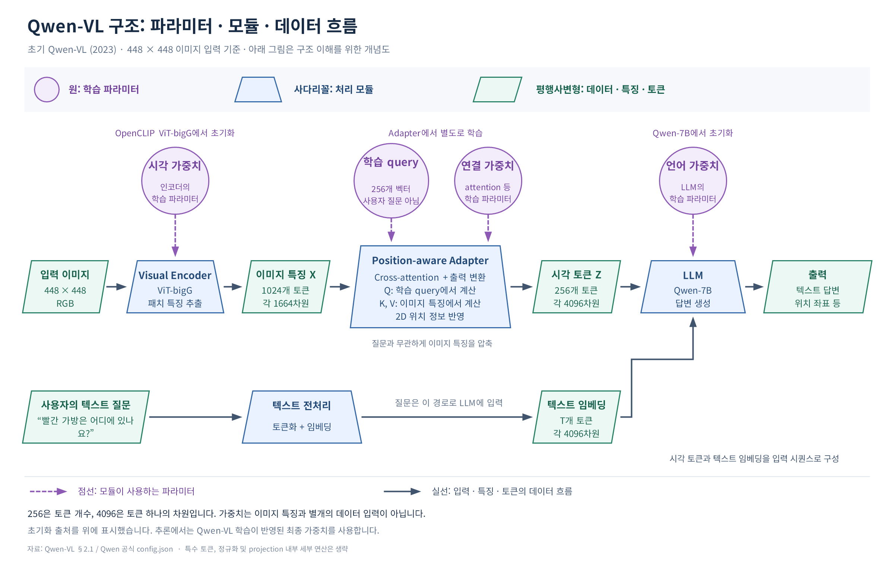

# Qwen-VL: LLM에 이미지를 읽고 위치를 찾는 능력을 연결하기

## 1. Introduction

카페 사진 한 장을 보고 질문한다고 해 보자. “테이블 위에 무엇이 있어?”에 답하려면 물체를 알아보면 된다. “메뉴판의 아메리카노 가격은 얼마야?”에는 사진 속 작은 글자까지 읽어야 한다. “빨간 가방은 어디에 있어?”에 박스로 답하려면 가방의 의미와 이미지 안의 위치를 연결해야 한다.

텍스트로 학습한 LLM은 이런 사진을 그대로 입력받아 처리할 수 없다. 이미지의 정보를 벡터로 표현하는 시각 모델과 연결해야 한다. 하지만 두 모델을 연결했다는 사실만으로 작은 글자, 객체 위치, 여러 이미지의 관계까지 잘 이해하게 되는 것은 아니다. 어떤 시각 정보를 전달하고, 그 정보를 언어 모델이 사용하도록 어떻게 학습시킬지가 함께 중요하다.

2023년에 공개된 Qwen-VL은 Qwen-7B를 기반으로 이미지 캡셔닝, 질의응답, 글자 읽기, visual grounding을 함께 수행하는 시각-언어 모델이다. 위치 정보를 반영하는 어댑터와 세 단계 학습을 결합해 이러한 능력을 학습한다. 여기서 다루는 모델은 초기 Qwen-VL과 Qwen-VL-Chat이다. [원논문 §1](https://arxiv.org/html/2308.12966v3#S1)

## 2. Background

### VLM과 LVLM

VLM(Vision-Language Model)은 이미지와 언어를 함께 다루는 모델을 넓게 가리킨다. 이미지와 텍스트의 표현을 정렬하는 CLIP도 이 범주에 들어간다. LVLM(Large Vision-Language Model)은 보통 LLM을 기반으로 시각 정보를 받아들이도록 만든 대규모 시각-언어 모델을 말한다. Qwen-VL은 여기에 해당한다.

두 용어를 나누는 보편적인 파라미터 수 기준이 정해져 있는 것은 아니다. 이 글에서는 VLM을 넓은 범주로, LVLM을 LLM 기반의 대규모 모델을 가리키는 표현으로 사용한다. CLIP에서 익숙한 이미지-텍스트 표현 정렬을 출발점으로 삼되, Qwen-VL에서는 이미지 정보를 조건으로 답변 토큰을 생성하는 과정까지 살펴보면 된다.

### 가중치, 초기화, 이미지 특징

사전 학습 가중치는 모델이 이미 배워 둔 계산 규칙이다. 이미지 특징은 그 규칙으로 특정 이미지를 처리한 결과다. 시각 인코더를 $E$, 가중치를 $\theta_v$, 입력 이미지를 $I$라고 하면 다음처럼 구분할 수 있다.

$$
X=E_{\theta_v}(I).
$$

$\theta_v$는 이미지가 바뀌어도 추론 중에는 유지되는 파라미터이고, $X$는 입력 이미지에 따라 달라지는 특징 벡터들의 집합이다. OpenCLIP ViT-bigG의 가중치로 초기화한다는 것은 $\theta_v$의 출발점을 가져온다는 뜻이다. OpenCLIP 가중치와 이미지 특징을 별도의 두 데이터로 준비해 서로 attention하는 구조가 아니다.

초기화(initialization)는 학습을 시작할 때 파라미터에 어떤 값을 넣는지에 관한 말이다. 추론할 때는 이후 Qwen-VL 학습까지 반영된 가중치를 사용한다.

### 패치와 스트라이드

패치(patch)는 이미지를 나눈 작은 영역이다. 패치 크기가 $14\times14$라면 가로와 세로가 각각 14픽셀인 영역을 처리한다. 스트라이드(stride)는 다음 영역을 추출할 때 위치를 얼마나 이동하는지를 뜻한다.

패치 크기가 14이고 스트라이드도 14이면 패치들이 겹치지 않는다. $448\times448$ 이미지는 가로 32개, 세로 32개의 패치로 나뉜다.

$$
N=\left(\frac{448}{14}\right)^2=32^2=1024.
$$

패치 자체는 픽셀 영역이고, 패치 임베딩은 그 영역을 벡터로 바꾼 표현이다. ViT는 위치 정보와 패치 사이의 관계를 반영하면서 이 표현을 갱신한다. 따라서 마지막에 나온 특징은 해당 패치의 원시 픽셀만 담은 값으로 볼 수 없다. Qwen-VL의 패치 추출 구현은 `kernel_size=patch_size`, `stride=patch_size`인 합성곱을 사용한다. [공식 배포 코드의 VisionTransformer](https://huggingface.co/Qwen/Qwen-VL/blob/da34fee90e0c97711c8933e0039f2b0f30b9b9fd/visual.py)

### 인코더, 디코더, 어댑터

어댑터(adapter)는 서로 다른 표현이나 모듈을 연결하도록 학습하는 구성 요소를 가리킨다. Encoder와 decoder를 통틀어 부르는 이름은 아니다. Encoder는 입력을 표현으로 바꾸는 역할에, decoder는 그 표현이나 이전 출력에 조건을 두고 출력을 만드는 역할에 초점을 둔 표현이다. Adapter는 두 구성 요소 사이의 표현을 맞추는 역할에 초점이 있다.

구체적인 모양은 모델마다 다르다. 선형 변환을 쓸 수도 있고, 여러 층의 신경망이나 cross-attention을 쓸 수도 있다. Qwen-VL의 어댑터는 위치 정보를 반영하는 단일 층 cross-attention을 중심으로 구성한다. 이 어댑터는 처음에는 무작위로 초기화하고, Qwen-VL 학습을 통해 가중치를 배운다. 공개된 완성 모델에는 학습된 어댑터도 포함된다. [원논문 §2.1](https://arxiv.org/html/2308.12966v3#S2.SS1)

### 임베딩, 시각 토큰, query

임베딩(embedding)은 입력을 모델이 계산할 수 있는 벡터로 표현한 것이다. 이 글에서는 시각 인코더 출력을 이미지 특징, 어댑터를 거쳐 LLM에 전달되는 벡터를 시각 토큰이라고 부른다. 시각 토큰도 이미지 특징의 일종이며, 자연어 단어나 캡션으로 번역된 결과는 아니다.

Cross-attention은 query가 다른 집합의 key·value를 참고해 정보를 모으는 연산이다. Qwen-VL 어댑터에서는 학습 가능한 벡터가 query를 만들고, 이미지 특징이 key·value를 만든다. 이 query는 사용자의 자연어 질문과 별개다. 사용자 질문은 텍스트 경로로 LLM에 들어간다.

벡터의 차원을 맞추는 것은 두 모듈을 연결하기 위한 조건이다. 그 벡터가 답변 생성에 유용한 의미를 전달하도록 만드는 과정은 학습이 담당한다.

### Visual grounding과 위치 인코딩

Visual grounding은 언어 표현을 이미지 속 대상이나 영역과 연결하는 작업이다. “빨간 가방”에 대응하는 박스를 찾는 것이 한 예다. 위치 인코딩(position encoding)은 벡터에 위치 정보를 반영하는 방법으로, Qwen-VL은 어댑터의 cross-attention에 2차원 위치 정보를 사용한다. [원논문 §2.1–2.2](https://arxiv.org/html/2308.12966v3#S2.SS1)

### 학습과 평가 용어

Freeze는 모듈의 파라미터 업데이트를 멈추는 설정이다. 고정한 모듈도 입력을 처리하는 계산에는 참여한다. SFT(Supervised Fine-tuning)는 정답 응답을 이용한 지도 미세조정이며, 이 논문에서는 지시와 대화에 맞추는 마지막 학습 단계를 가리킨다.

Interleaved data는 이미지와 텍스트가 번갈아 배치되는 데이터다. 평가에서 zero-shot은 문맥 예시를 주지 않는 설정, few-shot은 소수의 예시를 입력 문맥에 넣어 주는 설정을 가리킨다. 이때 예시를 주는 것과 모델 가중치를 업데이트하는 추가 미세조정은 구분한다.

## 3. Key Idea

Qwen-VL은 이미지의 세부 정보를 추출하는 시각 인코더, 이를 일정한 길이의 시각 토큰으로 모으는 어댑터, 시각 토큰과 질문을 받아 답을 생성하는 LLM을 연결한다. 여기에 위치를 표현하는 입출력 형식과 세 단계 학습을 함께 설계한다.

카페 사진에서 “빨간 가방은 어디에 있어?”라고 물었다고 하자. 시각 인코더는 사진의 여러 위치에서 특징을 얻는다. 어댑터는 이 특징들을 256개 벡터로 모으면서 공간 정보를 반영한다. LLM은 그 벡터들과 질문을 함께 처리해 가방의 위치를 나타내는 좌표 문자열을 생성한다.

어댑터가 전달한 시각 토큰을 바탕으로 문장이나 좌표 문자열을 생성하는 단계는 LLM이 담당한다.

## 4. Method

### 전체 구조: 이미지와 질문은 서로 다른 경로로 들어온다



Qwen-VL의 구조를 설명하는 개념도. 원은 학습 파라미터, 사다리꼴은 처리 모듈, 평행사변형은 데이터·특징·토큰을 나타낸다. 점선은 파라미터의 사용 관계, 실선은 데이터 흐름이다. $448\times448$ 입력을 기준으로 그렸으며, 정규화·특수 토큰 등의 세부 연산은 생략했다. [원논문 §2.1](https://arxiv.org/html/2308.12966v3#S2.SS1), [공식 모델 설정](https://huggingface.co/Qwen/Qwen-VL/blob/main/config.json)

그림의 위쪽에는 각 모듈이 사용하는 파라미터가 있고, 가운데에는 이미지가 처리되는 경로가 있다. 아래쪽의 사용자 질문은 토큰화와 임베딩을 거쳐 LLM으로 들어간다.

논문의 파라미터 규모는 다음과 같다. B는 10억 단위다. 모델 이름의 7B는 기반 언어 모델의 규모를 가리키며, 시각 인코더와 어댑터를 포함한 전체 모델은 논문 Table 1에서 약 9.6B로 보고한다.

| 구성 요소 | 초기화 | 파라미터 수 | 역할 |
|---|---|---:|---|
| Visual encoder | OpenCLIP ViT-bigG | 1.9B | 이미지에서 위치별 특징 추출 |
| Vision-language adapter | 무작위 초기화 | 0.08B | 특징을 256개 토큰으로 모으고 LLM 입력 표현에 연결 |
| LLM | 사전 학습된 Qwen-7B | 7.7B | 이미지와 텍스트에 조건을 두고 출력 생성 |
| 전체 | 논문이 보고한 근삿값 | 9.6B | 세 구성 요소를 연결한 모델 |

[원논문 Table 1](https://arxiv.org/html/2308.12966v3#S2.T1)

### 1) Visual encoder: 픽셀에서 위치별 특징으로

입력 이미지를 정해진 해상도로 조정한 뒤 ViT-bigG로 처리한다. 첫 학습 단계에서는 $224\times224$, 이후 단계와 공개 모델에서는 $448\times448$ 해상도를 사용한다.

공식 설정에서 시각 인코더의 특징 차원은 1664다. 배치 차원을 생략하면 $448\times448$ 입력의 인코더 출력은 다음처럼 나타낼 수 있다.

$$
X\in\mathbb{R}^{1024\times1664}.
$$

1024는 위치별 특징의 개수이고, 1664는 특징 하나를 표현하는 벡터의 차원이다. 이미지 한 장이 하나의 벡터로만 요약되는 것이 아니라 여러 위치의 특징 시퀀스로 남는다. 이 구분이 있어야 다음 단계의 ‘압축’이 무엇을 줄이는지 이해할 수 있다. [공식 config.json](https://huggingface.co/Qwen/Qwen-VL/blob/main/config.json)

### 2) Position-aware adapter: 1024개 특징을 256개 시각 토큰으로

입력 해상도를 높이면 작은 글자나 객체의 세부 정보를 보존하는 데 유리하지만, 시각 특징 시퀀스도 길어진다. 어댑터는 이 시퀀스를 256개로 모아 LLM에 전달한다.

어댑터에는 256개의 학습 가능한 query 벡터가 있다. 이를 $U$라고 하자. 각 query는 이미지 특징에서 정보를 모아 하나의 출력 벡터를 만든다.

공식 구현은 이미지 특징을 어댑터의 차원으로 선형 변환한 뒤 정규화하고, query와 key 쪽에 2차원 위치 정보를 반영해 cross-attention을 계산한다. [공식 배포 코드의 Resampler](https://huggingface.co/Qwen/Qwen-VL/blob/da34fee90e0c97711c8933e0039f2b0f30b9b9fd/visual.py)

연산의 원리를 한 attention head로 단순화하면 다음과 같다. $\widetilde U$와 $\widetilde X$는 필요한 차원 변환·정규화를 거친 query와 이미지 특징이고, $P_U$, $P_X$는 각 위치 정보를 뜻한다.

$$
Q=(\widetilde U+P_U)W_Q,\qquad
K=(\widetilde X+P_X)W_K,\qquad
V=\widetilde XW_V.
$$

$$
A=\mathrm{softmax}\!\left(\frac{QK^{\mathsf T}}{\sqrt{d_k}}\right),
\qquad Z_{\mathrm{head}}=AV.
$$

$W_Q$, $W_K$, $W_V$는 학습하는 변환 행렬이고, $d_k$는 한 head의 query·key 차원이다. Softmax는 각 query가 이미지 위치들에 나누어 줄 가중치를 만든다. $448\times448$ 입력에서는 $A$의 크기가 $256\times1024$다. 각 행이 이미지 특징 1024개를 참고해 하나의 출력 벡터를 만드는 셈이다.

따라서 attention 출력의 토큰 개수는 query 개수인 256을 따른다. 반면 벡터 하나의 차원은 value와 출력 변환의 설계에 달려 있다. 실제 모델은 multi-head attention과 이후 정규화·출력 변환을 사용하며, 최종 결과는 LLM 입력 차원에 맞춘 다음 형태다.

$$
Z\in\mathbb{R}^{256\times4096}.
$$

여기서 1024에서 256으로 줄어든 것은 토큰 수다. 토큰별 차원은 인코더의 1664에서 LLM에 맞는 4096으로 바뀐다.

위치 정보도 중요하다. “무엇이 있는가?”뿐 아니라 “어디에 있는가?”에 답해야 하기 때문이다. 2차원 절대 위치 인코딩은 특징을 모으는 과정에서 공간적 단서를 반영하도록 돕는다. 이것만으로 모든 위치 정보가 손실 없이 보존된다고 보장하는 것은 아니다. [원논문 §2.1](https://arxiv.org/html/2308.12966v3#S2.SS1)

### 3) LLM: 시각 토큰과 질문으로 다음 토큰을 생성

사용자의 질문은 텍스트 토큰으로 나뉜 뒤 4096차원 임베딩으로 표현된다. 어댑터가 만든 시각 토큰도 같은 입력 차원을 가지므로, 이미지와 텍스트를 하나의 입력 시퀀스 안에 배치할 수 있다.

개념적인 입력 순서는 다음과 같다. 대괄호 안의 내용은 설명용 표시이며 실제 문자열이 아니다.

```text
 [256개의 시각 벡터] </img> 빨간 가방은 어디에 있나요?
```

``와 `</img>`는 이미지 구간의 시작과 끝을 구분한다. LLM은 시각 토큰과 질문을 함께 처리하며 답변을 생성한다. [원논문 §2.2](https://arxiv.org/html/2308.12966v3#S2.SS2)

### 4) Grounding: 말과 이미지 위치를 연결하는 입출력

Qwen-VL은 박스를 왼쪽 위와 오른쪽 아래 모서리의 좌표로 표현한다. 좌표는 이미지 크기에 따라 정규화해 $[0,1000)$ 범위로 나타내고, 숫자와 구두점으로 이루어진 문자열을 텍스트처럼 토큰화한다. 좌표 전용의 별도 위치 어휘를 추가하지 않는다.

```text
<ref>빨간 가방</ref><box>(120,350),(420,800)</box>
```

위 숫자는 형식을 보여 주기 위한 예시다. `<ref>`와 `</ref>`는 대상 표현을, `<box>`와 `</box>`는 박스 좌표 구간을 구분한다. 모델은 이런 형식의 학습 데이터를 통해 표현과 위치의 대응을 배운다. 여기서 박스는 사각형 위치를 나타내며, SAM처럼 대상의 픽셀별 마스크를 출력하는 것은 아니다. [원논문 §2.2](https://arxiv.org/html/2308.12966v3#S2.SS2)

### 5) 학습 파이프라인: 단계에 따라 업데이트할 모듈을 바꾼다

Qwen-VL의 학습은 사전 학습, 멀티태스크 사전 학습, 지도 미세조정의 세 단계로 구성된다.

| 항목 | 1단계: Pre-training | 2단계: Multi-task pre-training | 3단계: Supervised fine-tuning |
|---|---|---|---|
| 학습 초점 | 대규모 이미지-텍스트 연결 | 세밀한 시각 이해와 여러 작업 | 사용자 지시와 대화 |
| 입력 해상도 | 224 × 224 | 448 × 448 | 448 × 448 |
| 인코더 특징 수 | 256 | 1024 | 1024 |
| 어댑터 출력 토큰 수 | 256 | 256 | 256 |
| 시각 인코더 | 학습 | 학습 | 고정 |
| 어댑터 | 학습 | 학습 | 학습 |
| LLM | 고정 | 학습 | 학습 |
| LLM 학습 시퀀스 길이 | 512 | 2048 | 2048 |
| 최대 학습률 | 2 × 10⁻⁴ | 5 × 10⁻⁵ | 1 × 10⁻⁵ |
| 학습 스텝 | 50,000 | 19,000 | 8,000 |
| 전역 배치 크기 | 30,720 | 4,096 | 128 |
| 단계 종료 모델 | 1단계 체크포인트 | Qwen-VL | Qwen-VL-Chat |

[원논문 §3 및 Appendix C, Table 8](https://arxiv.org/html/2308.12966v3#S3)

#### 1단계: 대규모 이미지-텍스트 쌍으로 연결을 학습

웹에서 수집한 약한 라벨의 이미지-텍스트 쌍을 주로 사용한다. 원래 약 50억 쌍에서 정제 후 약 14억 쌍을 남겼고, 텍스트 기준으로 영어가 77.3%, 중국어가 22.7%다. LAION, DataComp, Coyo, 캡셔닝 데이터와 자체 데이터 등을 사용한다.

이 단계에서는 LLM을 고정하고 시각 인코더와 어댑터를 학습한다. 처음부터 사전 학습된 시각 인코더도 업데이트 대상이라는 점이 중요하다. 최대 학습률은 $2\times10^{-4}$이며, 50,000스텝 동안 약 15억 개의 이미지-텍스트 샘플을 처리한다. 정제 데이터의 규모와 학습 중 처리한 샘플 수는 논문이 각각 근삿값으로 보고한 수치다. [원논문 §3.1, Table 2](https://arxiv.org/html/2308.12966v3#S3.SS1)

학습 목표는 정답 텍스트 토큰의 cross-entropy를 줄이는 것이다. 이미지와 프롬프트 등 입력 조건을 $C$, 정답 토큰을 $y_t$라고 하면 자기회귀 학습의 원리는 다음과 같다.

$$
\mathcal{L}=-\sum_{t\in\mathcal{T}}
\log p_{\theta}(y_t\mid C,y_{<t}).
$$

$y_{<t}$는 앞선 정답 토큰들이고, $\mathcal{T}$는 손실을 계산하는 정답 위치의 집합이다. 정답 토큰에 높은 확률을 줄수록 손실이 작아진다. 학습에서는 정답의 앞부분을 주고 다음 토큰을 예측하도록 한다. 추론에서는 이미 생성한 토큰을 이어 받아 다음 출력을 만든다.

LLM이 고정되어 있어도 그 계산을 통과해 시각 인코더와 어댑터가 손실을 줄이는 방향으로 학습될 수 있다. ‘LLM 가중치를 바꾸지 않는다’와 ‘LLM을 계산에서 제외한다’는 서로 다르다.

#### 2단계: 고해상도와 일곱 작업으로 전체 모델을 학습

입력 해상도를 $448\times448$로 높여 축소 과정에서 사라질 수 있는 세부 정보를 줄인다. 이때부터 시각 인코더, 어댑터, LLM을 모두 학습한다. 학습 목표는 앞 단계와 같은 텍스트 생성 손실이다.

학습 작업은 Captioning, VQA, Grounding, Ref Grounding, Grounded Captioning, OCR, Pure-text Autoregression의 일곱 종류다. [원논문 §3.2, Table 3](https://arxiv.org/html/2308.12966v3#S3.SS2)

VQA에는 자연 이미지·문서·차트·글자 중심 데이터를, grounding 계열에는 GRIT·Visual Genome·RefCOCO 계열을 사용한다. OCR에는 영어·중국어 합성 데이터와 Common Crawl의 PDF·HTML 데이터를 사용한다. 같은 작업의 데이터를 길이 2048의 시퀀스로 묶어 interleaved 입력을 구성한다.

Pure-text 데이터를 함께 사용하는 이유는 시각 정보를 배우는 동안 언어 모델의 텍스트 능력도 유지하려는 데 있다. 사진과 질문만 반복해서 보여 주는 학습으로 이해하면 이 부분을 놓치게 된다. [원논문 §3.2](https://arxiv.org/html/2308.12966v3#S3.SS2)

#### 3단계: 지시와 대화 형식으로 미세조정

2단계가 끝난 Qwen-VL을 바탕으로 약 35만 개의 지시·대화 데이터를 사용해 Qwen-VL-Chat을 만든다. 시각 인코더는 고정하고 어댑터와 LLM을 학습한다.

데이터에는 이미지 설명과 LLM이 생성한 대화뿐 아니라, 수작업 주석과 모델 생성 등을 이용해 구성한 위치 특정·여러 이미지 이해 대화도 포함한다. 멀티모달 대화와 텍스트 전용 대화를 함께 사용한다. 이 단계는 이미지 정보를 읽는 능력을 사용자와 주고받는 대화에 연결하는 과정으로 이해할 수 있다. [원논문 §3.3](https://arxiv.org/html/2308.12966v3#S3.SS3)

### 단계별 freeze를 어떻게 이해했나?

학습 대상을 바꾸는 설계가 흥미로웠다. 같은 세 모듈을 연결해 놓고도, 어느 단계에서는 LLM을 고정하고 다음 단계에서는 전체를 학습한 뒤 마지막에는 시각 인코더를 고정한다.

이 흐름을 이해하기 위한 내 해석은 다음과 같다. 1단계는 이미 언어를 아는 LLM을 기준으로 시각 인코더와 어댑터가 이미지를 전달하는 방법을 배우는 과정이다. 2단계에서는 해상도와 작업의 종류를 늘리면서 언어 모델까지 함께 조정한다. 3단계에서는 앞서 배운 시각 표현을 바탕으로 어댑터와 LLM을 사용자 지시·대화에 맞춘다.

다만 이것이 유일한 최적 설계라는 결론까지 나온 것은 아니다. 이 논문에서 제시한 학습 일정과 별개로, ‘처음부터 전체를 학습하는 방법’이나 ‘끝까지 어댑터만 학습하는 방법’과의 차이는 같은 데이터·계산 조건의 비교 실험이 있어야 판단할 수 있다. 이 질문은 Discussion에서 다시 남겨 둔다.

## 5. Experiments & Results

### 평가 설정

2단계까지 학습한 Qwen-VL과 SFT를 마친 Qwen-VL-Chat을 이미지 캡셔닝, 일반 VQA, 텍스트 중심 VQA, grounding, 지시 따르기로 나누어 평가한다. 캡셔닝은 CIDEr, 질의응답은 벤치마크별 정답 일치 점수, 문서는 문자열 유사도인 ANLS 등을 사용한다. RefCOCO 계열은 예측 박스와 정답 박스의 IoU가 0.5 이상인 비율로 평가한다. [원논문 Table 9](https://arxiv.org/html/2308.12966v3#A4.T9), [공식 grounding 평가 코드](https://github.com/QwenLM/Qwen-VL/blob/master/eval_mm/evaluate_grounding.py)

캡셔닝과 일반 VQA는 greedy decoding으로 답변을 생성하고, ScienceQA는 주어진 선택지 중 신뢰도가 가장 높은 답을 고른다. 아래 성능 비교는 논문 발표 당시 제시한 비교 모델과 평가 조건을 기준으로 한다. [원논문 §4.1](https://arxiv.org/html/2308.12966v3#S4.SS1)

### 이미지 캡셔닝과 일반 VQA

Flamingo-80B, BLIP-2, InstructBLIP 등과 비교했다. Qwen-VL은 Flickr30K의 제로샷 캡셔닝과 VQAv2·OKVQA·GQA에서 논문의 범용 모델 비교군 중 1위를 기록했다. Nocaps에서는 InstructBLIP이 조금 더 높았고, Qwen-VL-Chat은 ScienceQA-Img와 VizWiz에서 범용 비교군 최고 성능을 보였다. [원논문 Table 4](https://arxiv.org/html/2308.12966v3#S4.T4)

### 텍스트 중심 VQA

InstructBLIP, mPLUG-DocOwl, Pix2Struct 등과 비교했다. Qwen-VL 계열은 TextVQA·DocVQA·ChartQA·AI2D·OCR-VQA의 다섯 벤치마크 중 네 개에서 범용 비교군 최고 성능을 보였다. DocVQA는 Pix2Struct가 더 높았다. 작업별로 미세조정한 PALI-X-55B가 앞서는 평가도 있어, 범용 모델로 여러 작업을 함께 다룬다는 점에 의미가 있다. [원논문 Table 5](https://arxiv.org/html/2308.12966v3#S4.T5)

### Grounding 성능

Shikra, OFA 등과 비교했으며, Qwen-VL 계열은 RefCOCO·RefCOCO+·RefCOCOg에서 범용 비교군의 최상위 성능을 보였다. 다만 ONE-PEACE 같은 작업 특화 모델은 더 높은 결과를 보였다. 언어 표현과 이미지 위치를 연결하는 능력을 갖추면서도 전용 모델과는 차이가 남아 있다. [원논문 Table 6](https://arxiv.org/html/2308.12966v3#S4.T6)

### 퓨샷 성능은?

OKVQA, VizWiz, TextVQA, Flickr30K에서 문맥 예시를 주었을 때의 성능을 평가했다. Qwen-VL은 비슷한 규모의 Flamingo-9B, OpenFlamingo-9B, IDEFICS-9B보다 좋은 결과를 보였고, 일부 설정에서는 Flamingo-80B·IDEFICS-80B 같은 더 큰 모델과도 견줄 만했다. 예시는 무작위로 선택했다. [원논문 §4.4, Figure 4](https://arxiv.org/html/2308.12966v3#S4.SS4)

### 지시 따르기 성능

InstructBLIP, LLaVA, mPLUG-Owl 등과 비교한 TouchStone, SEED-Bench, MME 평가에서 Qwen-VL-Chat은 논문에 실린 비교군 중 TouchStone·MME와 SEED 전체 점수가 가장 높았다. SEED의 비디오 평가는 네 프레임을 입력했으며, 이 항목은 Qwen-VL이 Chat보다 높았다. SFT의 효과가 모든 평가에서 일괄적인 성능 향상으로 나타나지는 않는다. [원논문 §4.5, Table 7](https://arxiv.org/html/2308.12966v3#S4.SS5)

### 시각 토큰 수 실험

Query 수를 바꾼 실험에서는 정보량과 수렴·계산량의 균형을 고려해 256개를 선택했다. 이 실험은 ViT-L/14와 224 × 224 입력을 사용했으므로 최종 모델의 모든 작업에서 256개가 최적이라는 의미는 아니다. [원논문 Appendix E.2](https://arxiv.org/html/2308.12966v3#A5.SS2)

## 6. Discussion

### 추가로 궁금한 점

가장 궁금한 것은 freeze 일정의 효과다. 왜 이 순서가 좋은지 더 이해하려면 같은 데이터와 계산 예산에서 학습 전략을 바꾸어 봐야 할 것 같다. 특히 다음 질문이 남았다.

- 1단계부터 전체 모델을 학습하면 시각-언어 연결의 수렴과 기존 언어 능력이 어떻게 달라질까?
- 끝까지 어댑터만 학습하면 비용은 얼마나 줄고, OCR·grounding·일반 VQA 성능은 각각 얼마나 달라질까?
- 3단계에서 시각 인코더까지 업데이트하면 지시 따르기와 세부 시각 이해에 어떤 변화가 생길까?
- 작은 글자와 객체 위치를 다룰 때 256개 토큰이라는 제한은 어느 상황에서 병목이 될까?

이 질문들은 논문의 학습 파이프라인을 보고 생긴 후속 질문이다. 앞의 query 수 실험이 freeze 일정의 효과까지 검증하는 것은 아니다.

### 활용과 적용 조건

Qwen-VL은 이미지 내용을 설명하는 대화뿐 아니라 문서·차트 질의응답이나 언어로 지정한 대상의 위치 찾기에도 연결할 수 있다. 여러 이미지가 들어가는 입력과 영어·중국어 중심의 학습 데이터도 중요한 특징이다. 다만 영어·중국어 평가 결과만으로 한국어를 포함한 모든 언어의 성능이 같다고 볼 수는 없다.

구조를 보며 생각해 볼 제약도 있다. 고정 해상도로 줄이는 과정에서 아주 작은 글자가 사라질 수 있고, 256개 토큰으로 모으면서 세부 정보가 충분히 전달되지 않을 수도 있다. 이는 구조에서 예상할 수 있는 한계이며, 벤치마크 결과가 모든 문서나 작은 객체에서의 정확도를 보장하는 것은 아니다.

논문은 향후 방향으로 음성·비디오 등 모달리티 확장, 모델·데이터·해상도 확장, 이미지·음성 생성 능력 확장을 제시한다. 초기 Qwen-VL이 실제로 구현하고 평가한 범위와 이후 연구 방향을 구분해서 읽는다. [원논문 §6](https://arxiv.org/html/2308.12966v3#S6)

## 7. Summary

Qwen-VL의 차별점은 세밀한 시각 정보를 전달하는 구조와, 그 정보를 사용하도록 학습하는 데이터·최적화 과정을 함께 설계한 데 있다.

구조에서는 위치 정보를 반영하는 cross-attention 어댑터를 사용한다. 선형 projection으로 이미지와 LLM을 연결하는 초기 LLaVA와 비교하면, Qwen-VL은 학습 query가 이미지 특징을 모으는 과정에 2차원 위치 정보를 반영하고 출력을 256개 토큰으로 제한한다. 이는 위치 단서를 반영하면서 LLM에 전달할 시퀀스 길이를 관리하는 설계다. [초기 LLaVA 구조](https://llava-vl.github.io/), [Qwen-VL §2.1](https://arxiv.org/html/2308.12966v3#S2.SS1)

입력과 학습 데이터에서는 고해상도와 세밀한 정답을 함께 사용한다. OpenCLIP ViT-bigG와 Qwen-7B를 기반으로 약 14억 이미지-텍스트 쌍을 학습한 뒤, 448 × 448 해상도에서 OCR·문서·차트 질의응답·grounding 등을 함께 학습한다. 해상도는 작은 글자와 객체의 단서를 더 남기는 역할을 하고, 관련 정답 데이터는 그 단서를 읽거나 위치와 연결하도록 학습시키는 역할을 한다. [Qwen-VL §3.1–3.2](https://arxiv.org/html/2308.12966v3#S3.SS1)

학습 범위도 중요한 차이다. 시각 인코더와 LLM을 고정하는 BLIP-2의 사전 학습과 비교하면, Qwen-VL은 1단계부터 시각 인코더를 업데이트하고 2단계에서는 어댑터·LLM까지 전체를 함께 학습한다. 이후 시각 인코더를 고정하고 지시·대화에 맞추는 SFT를 진행한다. 시각 표현과 언어 모델을 세밀한 여러 작업에 함께 맞춘 뒤 대화 능력을 조정하는 흐름이다. [BLIP-2 학습 방식](https://arxiv.org/abs/2301.12597), [Qwen-VL §3](https://arxiv.org/html/2308.12966v3#S3)

이 조합으로 Qwen-VL은 일반 질의응답뿐 아니라 글자 읽기와 위치 이해에서도 당시 범용 비교군의 상위 성능을 보였다. [Qwen-VL §4](https://arxiv.org/html/2308.12966v3#S4) 다만 벤치마크는 전체 시스템의 결과이며, 위치 인코딩이나 freeze 일정 각각이 개선에 얼마나 기여했는지를 따로 입증한 것은 아니다. 성능 향상은 강한 사전 학습 모델, 어댑터, 데이터, 단계별 학습이 결합된 결과로 이해하는 것이 적절하다.
