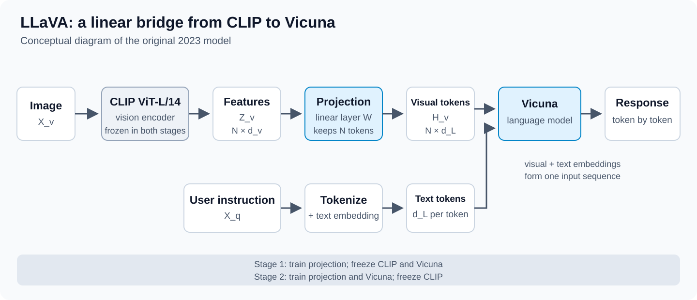
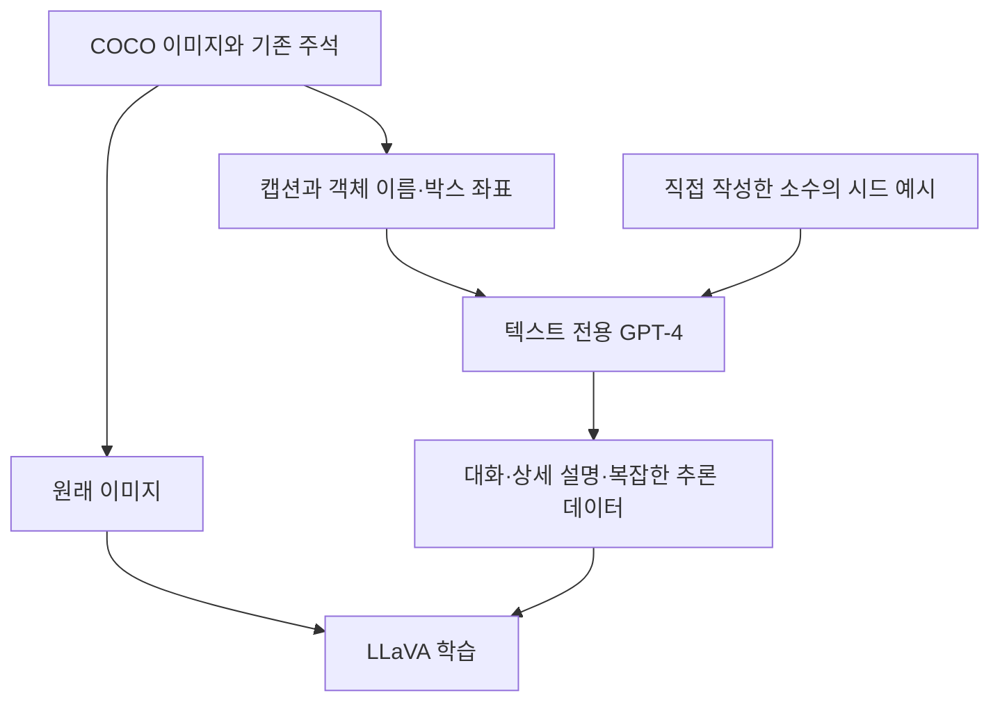
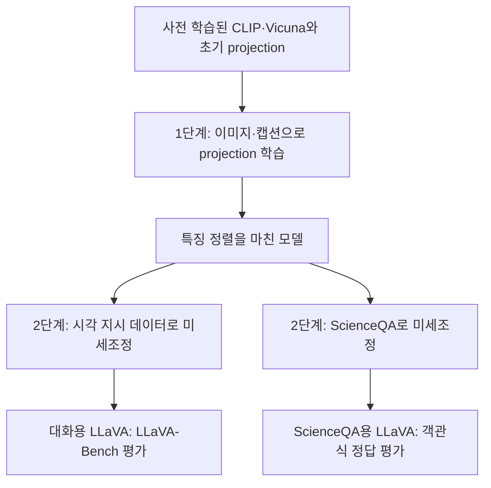

# LLaVA: 이미지와 대화를 연결하는 시각 지시 학습

## 1. Introduction

여행을 떠나려는 사람들이 자동차 앞에 여러 가방을 모아 둔 사진이 있다고 해 보자. “무엇이 보이나요?”에는 사람, 자동차, 여행 가방을 설명하면 된다. “가방이 몇 개 있나요?”에는 특정 물체를 찾아 세어야 한다. “이 사람들이 짐을 싣는 데 어떤 어려움을 겪을까요?”에는 사진 속 관계를 바탕으로 상황을 해석해야 한다. 같은 이미지라도 사용자가 요청하는 작업에 따라 답변이 달라진다. 이 글의 질문들은 작동 방식을 설명하기 위한 예시다.

이미지 내용을 설명하는 캡션 데이터는 많이 존재하지만, 그것만으로 사용자의 다양한 지시에 맞춰 대화하는 능력이 충분히 학습되는 것은 아니다. 이미지와 언어를 연결하는 모델 구조뿐 아니라, 어떤 질문에 어떤 형식과 내용으로 답해야 하는지를 보여 주는 데이터가 필요하다.

2023년의 「Visual Instruction Tuning」은 이 문제를 시각 지시 학습으로 다룬다. 기존 CLIP 시각 인코더와 Vicuna 언어 모델을 단순한 선형 층으로 연결하고, GPT-4로 생성한 시각 지시·답변 데이터로 학습한 모델이 LLaVA(Large Language and Vision Assistant)다. 여기서는 LLaVA-1.5나 후속 버전과 구분해 초기 LLaVA를 살펴본다. [원논문 §1](https://arxiv.org/html/2304.08485v2#S1)

## 2. Background

### Vicuna와 시각 지시 학습

Vicuna는 LLaMA를 사용자 대화 데이터로 미세조정한 LLM이다. 초기 LLaVA에서는 이미지 정보를 참고하면서 답변을 생성하는 언어 모델로 사용한다. 이미지를 처리하는 부분까지 포함한 전체 모델의 이름이 LLaVA이고, 그 안에서 언어 생성을 담당하는 부분이 Vicuna다. [Vicuna 공식 소개](https://www.lmsys.org/blog/2023-03-30-vicuna/)

지시 학습(instruction tuning)은 사용자의 요청과 그에 적절한 답변을 짝지어 모델을 학습하는 방식이다. 시각 지시 학습에서는 요청이 이미지와 연결된다. “짧게 설명해 줘”, “물체를 세어 줘”, “상황을 해석해 줘”처럼 서로 다른 요청에 맞춰 답하도록 학습한다. 이미지 QA에도 추론 문제가 있으므로, 캡셔닝·QA·지시 학습을 단순히 답변 길이로 나누지는 않는다.

LLaVA가 이미지 QA를 처음 만든 것은 아니다. 앞선 Flamingo와 BLIP-2도 시각 질의응답을 수행했다. 이 논문에서 저자들이 강조하는 새로운 시도는 텍스트 전용 GPT-4로 이미지에 관한 지시 수행 데이터를 만들고, 그 데이터로 범용 시각 대화를 학습하는 것이다. [원논문 Abstract·§2](https://arxiv.org/html/2304.08485v2#S2)

### 토큰 수와 벡터 차원은 다르다

이미지 특징은 여러 벡터가 모인 시퀀스다. 특징이 $N$개이고 각 벡터가 $d_v$개의 숫자로 이루어져 있다면, 행렬의 크기를 $N\times d_v$로 나타낼 수 있다. 여기서 $N$은 벡터 개수이고 $d_v$는 벡터 하나의 차원이다.

선형 projection은 학습 가능한 행렬을 사용해 각 벡터를 다른 표현으로 변환한다. LLaVA에서는 각 시각 벡터를 LLM의 입력 차원 $d_L$에 맞춘다. $N\times d_v$가 $N\times d_L$로 바뀌므로 토큰 수는 유지된다. 차원을 맞추는 것은 필요한 조건이고, 실제로 LLM이 활용할 수 있는 표현을 만들도록 가중치를 학습해야 한다. 벡터가 단어 문자열로 바뀌는 것은 아니다.

반면 Qwen-VL에서 보았던 query 기반 adapter는 여러 위치의 특징을 모아 출력 토큰 수를 정한다. 448 × 448 입력에서 특징 1024개를 256개 토큰으로 모으는 것이 그 예다. 여기서 ‘압축’은 토큰 수를 줄인다는 뜻이며, 벡터 하나의 차원까지 작아진다는 뜻은 아니다. [LLaVA §4.1](https://arxiv.org/html/2304.08485v2#S4.SS1), [Qwen-VL §2.1](https://arxiv.org/html/2308.12966v3#S2.SS1)

### Flamingo의 gated cross-attention

Cross-attention은 한쪽 표현이 다른 쪽 표현에서 필요한 정보를 가져오는 연산이다. Flamingo에서는 언어 모델의 중간 텍스트 표현이 query가 되고, 이미지에서 얻은 표현이 key와 value가 된다. 예를 들어 ‘가방’을 설명할 차례의 텍스트 표현이 이미지의 관련 특징을 참고할 수 있다.

Flamingo는 이미지 특징을 Perceiver Resampler로 모은 뒤, 고정된 언어 모델의 층 사이에 새 cross-attention 블록을 삽입한다. Gate는 새 블록의 출력이 기존 표현에 얼마나 더해질지를 조절하는 학습 가능한 장치다. 원논문에서는 새 블록 출력을 $\tanh(\alpha)$로 조절하며 $\alpha$를 0에서 시작한다. 처음에는 기존 언어 모델의 동작을 유지하고, 학습하면서 시각 정보의 영향을 반영하도록 설계한 것이다. 사전 학습 과정에서 기존 시각 인코더와 언어 모델은 고정하고 새 연결 모듈들을 학습한다. [Flamingo §2.1–2.2·Figure 4](https://arxiv.org/html/2204.14198v2#S2.SS2)

### BLIP-2의 Q-Former

Q-Former(Querying Transformer)는 학습 가능한 query를 사용해 이미지 특징에서 정보를 추출하는 Transformer다. BLIP-2에서는 32개의 query가 self-attention으로 서로 정보를 주고받으며, cross-attention으로 고정된 시각 인코더의 특징을 읽는다. 출력은 query 개수에 대응하는 32개 벡터다.

이미지·텍스트의 대조, 이미지 기반 텍스트 생성, 이미지·텍스트 매칭으로 Q-Former를 사전 학습한 뒤, 출력 벡터를 선형 변환해 고정된 LLM의 입력 앞에 붙인다. 이 과정에서 시각 인코더와 LLM은 고정한다. 학습 query로 정보를 모은다는 점은 Qwen-VL의 adapter와 연결해서 볼 수 있지만, Q-Former의 Transformer 구조와 사전 학습 목표까지 같은 것은 아니다. [BLIP-2 §3.1–3.3·Figure 2–3](https://arxiv.org/html/2301.12597v3#S3)

세 방식의 연결 위치를 비교하면 다음과 같다. 아래의 학습 범위는 각 논문이 설명하는 해당 학습 과정의 기준이다.

| 접근 | 이미지와 언어를 연결하는 방식 | 학습 범위의 특징 |
|---|---|---|
| 초기 LLaVA | 위치별 시각 특징을 선형 변환해 LLM 입력에 배치 | 1단계는 projection, 2단계는 projection·LLM 학습 |
| Flamingo | Resampler 출력에 cross-attention하는 블록을 LLM 층 사이에 삽입 | 기존 시각 인코더·LLM을 고정하고 새 모듈 학습 |
| BLIP-2 | Q-Former가 모은 query 출력을 변환해 LLM 입력 앞에 배치 | 시각 인코더·LLM을 고정하고 Q-Former와 연결 층 학습 |

### 자기회귀 생성, teacher forcing, 종료 표시

자기회귀 생성은 지금까지의 문맥으로 다음 토큰을 예측하고, 그 결과를 문맥에 추가하는 방식이다. 학습에서는 정답 답변의 앞부분을 제공하고 다음 정답 토큰을 예측한다. 이를 teacher forcing이라고 한다. 추론에서는 정답 대신 모델이 앞서 생성한 토큰을 사용한다. 한 번에 전체 학습 시퀀스를 처리하더라도 causal mask가 미래 토큰을 보지 못하게 한다.

대화에는 발화 구간을 구분하는 표시도 필요하다. 논문 Table 2의 `<STOP>`은 발화의 끝을 나타내는 표기이며, 해당 구현에서는 `###`을 사용한다. 기다리거나 시간을 지연시키라는 명령이 아니다. 어시스턴트가 답변을 끝내는 위치도 학습한다. 생성이 끝난 뒤 다음 사용자 입력을 기다리는 동작은 실행 프로그램이 관리한다. [원논문 §4.2·Table 2](https://arxiv.org/html/2304.08485v2#S4.SS2)

### 종단 간 학습과 freeze

종단 간(end-to-end) 학습은 최종 출력의 손실을 기준으로 연결된 학습 대상들을 함께 조정하는 방식이다. 모든 모듈의 가중치를 반드시 바꾼다는 뜻은 아니다. LLaVA의 두 번째 단계는 시각 인코더를 freeze한 상태에서 projection과 LLM을 함께 학습한다. Freeze는 해당 가중치를 고정한다는 뜻이며, 모델을 계산 흐름에서 제거한다는 뜻은 아니다. [원논문 §4.2](https://arxiv.org/html/2304.08485v2#S4.SS2)

## 3. Key Idea

LLaVA의 핵심은 이미 학습된 시각 모델과 언어 모델을 가벼운 연결 층으로 이어 놓고, 기존 이미지 주석을 다양한 지시·답변 데이터로 확장해 그 연결을 학습하는 것이다.

앞의 여행 사진에 “사람들이 자동차에 가방을 싣고 있다”라는 캡션이 있다고 해 보자. 여기에 “이미지를 설명해 줘”라는 질문만 붙이면 학습 데이터를 쉽게 만들 수 있다. 그러나 답변이 늘 기존 캡션이면 질문의 종류와 요구하는 사고의 폭이 제한된다.

저자들은 캡션과 객체 이름·박스 좌표를 텍스트 전용 GPT-4에 제공한다. GPT-4는 이 정보를 바탕으로 이미지에 관한 대화, 상세 설명, 복잡한 추론 데이터를 만든다. 원래 이미지와 생성한 대화를 묶어 학습하면, LLaVA는 시각 특징을 사용해 여러 지시에 맞춰 답하는 방법을 배울 수 있다. ‘자동차에 짐을 싣는 장면’ 예시는 원논문 Table 1에서도 사용한다. [원논문 §3·Table 1](https://arxiv.org/html/2304.08485v2#S3)

이때 GPT-4가 받는 입력과 LLaVA가 받는 입력은 다르다. 데이터 생성용 GPT-4는 이미지 픽셀을 직접 보지 않고 이미지에 대한 텍스트 정보를 받는다. 학습하는 LLaVA는 실제 이미지와 생성된 질문·답변을 함께 받는다.

## 4. Method

### 전체 흐름: 시각 표현과 질문을 한 입력으로



원논문 Figure 1·§4를 바탕으로 직접 작성한 구조 개념도. 입력과 출력은 간단히 표현했으며, 단계별 학습 대상은 그림 아래에 표시했다. [그림 출처와 생략한 내용](../../assets/images/llava/SOURCES.md)

사진은 CLIP 시각 인코더와 projection을 거쳐 시각 벡터 시퀀스가 된다. 사용자 질문도 텍스트 토큰의 임베딩 시퀀스가 된다. 두 표현을 같은 입력 차원으로 맞춰 Vicuna에 전달하면, 모델은 이미지와 질문, 앞선 대화를 조건으로 답변을 생성한다.

그림에서 각 모듈이 받는 것과 내보내는 것을 나누면 다음과 같다. $N$은 시각 특징 수, $d_v$는 시각 특징 차원, $d_L$은 Vicuna의 입력 차원이다.

| 구성 요소 | 입력 | 수행하는 일과 출력 |
|---|---|---|
| CLIP ViT-L/14 | 이미지 픽셀 | 여러 위치의 시각 특징 $N\times d_v$ 추출 |
| 선형 projection | CLIP의 위치별 특징 | 각 벡터를 변환해 시각 임베딩 $N\times d_L$ 생성; 토큰 수 유지 |
| 텍스트 임베딩 층 | 질문·대화의 텍스트 토큰 ID | 토큰마다 $d_L$차원 벡터 생성 |
| Vicuna | 시각·텍스트 임베딩을 배치한 시퀀스 | 다음 답변 토큰의 확률 분포를 계산하고 답변을 이어서 생성 |

시각 인코더는 무엇이 보이는지 표현하고, projection은 그 표현을 Vicuna의 입력에 연결한다. 최종 답변의 내용과 형식은 이 입력을 받은 Vicuna가 생성한다. 따라서 연결 층에서 차원을 맞추는 역할과, 언어 모델에서 질문에 맞는 답을 만드는 역할을 구분해 볼 수 있다. [원논문 §4.1·Figure 1](https://arxiv.org/html/2304.08485v2#S4.SS1)

### 1) 시각 인코더와 projection

이미지 $X_v$를 CLIP ViT-L/14에 넣어 위치별 특징 $Z_v=g(X_v)$를 얻는다. 논문은 마지막 Transformer 층을 통과하기 전과 후의 특징을 실험하며, ScienceQA의 최상 설정은 마지막 층 직전 특징을 사용한다. 여기서 사용하는 것은 이미지 전체를 하나로 요약한 CLIP의 최종 대조 학습용 벡터가 아니라, 여러 위치에 대응하는 특징들이다. [원논문 §4.1·§5.2](https://arxiv.org/html/2304.08485v2#S4.SS1)

벡터를 행으로 놓으면, 배치 차원을 생략한 특징과 선형 연결을 다음처럼 쓸 수 있다. 논문 식 (1)의 행렬 배치 방향을 바꾼 표기다.

$$
Z_v\in\mathbb{R}^{N\times d_v},\qquad
W\in\mathbb{R}^{d_v\times d_L},\qquad
H_v=Z_vW\in\mathbb{R}^{N\times d_L}.
$$

$N$은 이미지 특징의 개수, $d_v$는 CLIP 특징 차원, $d_L$은 Vicuna 입력 차원이다. $W$는 학습하는 projection 행렬이다. 같은 변환을 각 행에 적용하므로 출력도 $N$개의 벡터다. 이 연결 연산 자체는 여러 위치를 모아 토큰 수를 줄이지 않는다. 입력 특징에는 이미 시각 인코더가 처리한 문맥이 반영되어 있다.

예를 들어 설명용으로 특징 네 개의 차원을 3에서 5로 바꾸면 $4\times3$이 $4\times5$가 된다. 특징 네 개는 그대로 남고, 특징 하나를 표현하는 방식이 바뀐다. 실제 초기 공식 코드도 `nn.Linear(vision_config.hidden_size, model.config.hidden_size)`로 연결 층을 구성한다. [초기 공식 학습 코드](https://github.com/haotian-liu/LLaVA/blob/a6b01a246683e82cd1af9c6c0bd7338995cef1c5/llava/train/train.py)

### 2) 언어 지시와 여러 턴의 대화

“가방이 몇 개 있나요?”라는 질문은 토큰화와 텍스트 임베딩을 거친다. 시각 벡터와 텍스트 벡터는 모두 Vicuna의 입력 차원을 가지므로 하나의 시퀀스 안에 배치할 수 있다. 첫 턴에는 이미지와 질문의 순서를 두 방식 중 무작위로 선택하고, 이후 턴에는 질문을 추가한다. 앞선 이미지와 대화는 문맥으로 남는다.

논문 Table 2의 형식을 설명용 예시로 나타내면 다음과 같다. `[이미지의 시각 벡터]`는 실제 문자열이 아니다.

```text
[시스템 메시지] <STOP>
Human: [이미지의 시각 벡터] 가방이 몇 개 있나요? <STOP>
Assistant: 세 개입니다. <STOP>
Human: 사람들은 무엇을 하고 있나요? <STOP>
Assistant: 자동차에 짐을 싣고 있습니다. <STOP>
```

LLM은 문맥 전체를 참고하지만, 손실은 어시스턴트가 생성해야 할 답변과 종료 위치를 대상으로 계산한다. 사용자 질문까지 정답 출력으로 똑같이 학습하는 설정과 구분해야 한다. 논문은 이를 Table 2의 색으로 표시하며, 초기 코드에서는 시스템·사용자 입력 구간의 타깃을 마스킹한다. [원논문 §4.2·Table 2](https://arxiv.org/html/2304.08485v2#S4.SS2), [공식 데이터 전처리](https://github.com/haotian-liu/LLaVA/blob/a6b01a246683e82cd1af9c6c0bd7338995cef1c5/llava/train/train.py)

### 3) 학습 수식: 현재 정답 토큰에 높은 확률을 주기

정답 답변이 학습 데이터에 들어 있다는 것과, 다음 정답 토큰을 모델이 미리 볼 수 있다는 것은 다르다. 다음 토큰의 확률을 계산할 때 참고하는 것은 이미지와 현재까지의 지시, 그리고 앞선 정답 토큰들이다.

논문 식 (3)의 원리를 한 턴의 답변으로 단순화해 보자. 이미지와 질문 등 입력 조건을 $C$, 답변 토큰을 $x_1,\ldots,x_M$이라고 하면 다음과 같다. $M$에는 답변의 종료를 표현하는 토큰들도 포함한다.

$$
p_{\theta}(x_1,\ldots,x_M\mid C)
=\prod_{i=1}^{M}
p_{\theta}(x_i\mid C,x_1,\ldots,x_{i-1}).
$$

소문자 $x_i$는 지금 예측할 정답 토큰이다. 이미지 $X_v$나 답변 전체를 뜻하지 않는다. $p_{\theta}$는 현재 파라미터 $\theta$를 가진 모델이 계산하는 확률이다. 모델은 다음 위치의 어휘 전체에 대한 확률 분포를 만들고, 학습에서는 그중 정답 토큰에 부여한 확률을 평가한다.

예를 들어 답변이 “세 개”이고, 설명을 위해 `[세] [개] [종료]`로 나뉜다고 가정하자. 실제 토큰 분할은 다를 수 있다.

```text
이미지 + 질문                 → 정답 토큰 '세'의 확률
이미지 + 질문 + '세'          → 정답 토큰 '개'의 확률
이미지 + 질문 + '세 개'       → 종료 표시의 확률
```

각 확률이 설명용으로 0.6, 0.5, 0.8이라면 이 정답 시퀀스에 부여한 확률은 $0.6\times0.5\times0.8=0.24$다. 각 위치에서 정답 토큰에 더 높은 확률을 주도록 학습한다.

최적화할 때는 같은 목표를 음의 로그 우도, 즉 정답 토큰의 cross-entropy를 줄이는 형태로 나타낸다.

$$
\mathcal{L}
=-\sum_{i=1}^{M}
\log p_{\theta}(x_i\mid C,x_1,\ldots,x_{i-1}).
$$

첫 위치에는 앞선 답변 토큰이 없으므로 $C$만 사용한다. 여러 턴의 대화로 확장하면 앞선 질문과 답변도 문맥에 포함하며, 전체 시퀀스 중 어시스턴트 답변·종료 위치에만 손실을 적용한다. 추론에서는 정답의 앞부분을 제공하지 않고 모델이 생성한 앞부분을 사용한다. [원논문 §4.2·식 (3), Table 2](https://arxiv.org/html/2304.08485v2#S4.SS2)

### 4) 데이터 생성: 텍스트 정보로 시각 대화를 만든다

GPT-4에 이미지 캡션과 객체 이름·박스 좌표를 제공하면, 직접 이미지 픽셀을 입력하지 않아도 장면에 관한 지시·답변을 만들 수 있다. 저자들은 COCO 이미지를 바탕으로 각 데이터 유형의 소수 예시를 직접 작성하고, 이를 GPT-4의 문맥 내 학습 예시로 제공한다. 이 예시는 GPT-4를 새로 미세조정하는 학습 데이터가 아니라 생성 요청에 넣는 시드다.

생성하는 작업은 여러 턴의 대화, 상세한 이미지 설명, 단계적 추론을 요구하는 질문의 세 종류다. 총 15만 8천 개 샘플을 구성한다. 대화에는 객체의 종류·개수·행동·위치 관계 등을 포함하며, 제공한 정보로 명확하게 답할 수 있는 질문을 만들도록 요청한다. 상세 설명과 복잡한 추론 데이터는 한 턴으로 구성한다. [원논문 §3](https://arxiv.org/html/2304.08485v2#S3)



GPT-4는 데이터 생성용 교사로 사용된다. 이후 기본 LLaVA 챗봇이 답변할 때마다 GPT-4에 질문해야 하는 구조는 아니다. ScienceQA에서 두 모델의 출력을 결합하는 실험은 별도로 다룬다.

### 5) 두 단계 학습과 두 가지 미세조정 용도

처음부터 모든 파라미터를 업데이트하지 않는다. 먼저 고정된 두 모델 사이의 연결을 학습하고, 다음에는 언어 모델까지 함께 조정한다. 학습 목표는 앞에서 설명한 다음 정답 토큰의 손실이며, 단계에 따라 그 손실로 업데이트하는 모듈을 바꾼다.

| 항목 | 1단계: 특징 정렬 사전 학습 | 2단계: 지시 미세조정 |
|---|---|---|
| 초점 | 이미지 특징을 LLM 입력에 연결 | 시각 정보를 사용해 지시에 맞게 답변 |
| 시각 인코더 | 고정 | 고정 |
| Projection | 학습 | 학습 |
| Vicuna | 고정 | 학습 |
| 정답으로 예측할 내용 | 기존 이미지 캡션과 종료 | 지시에 맞는 답변 또는 추론·정답과 종료 |
| 다음 단계에 전달할 것 | 이미지와 연결되도록 학습한 projection | 해당 용도에 맞춰 조정한 projection과 Vicuna |

Vicuna의 파라미터를 $\phi$라고 하면, 논문의 학습 대상은 1단계에서 $\theta=W$, 2단계에서 $\theta=\{W,\phi\}$로 바뀐다. 1단계도 LLM의 출력을 통해 손실을 계산하지만, 가중치 업데이트는 연결 층에만 적용한다. 2단계에서는 같은 손실이 연결 층과 언어 모델을 함께 조정한다.

1단계에서는 CC3M을 필터링한 약 59만 5천 개 이미지·텍스트 쌍을 사용한다. “이미지를 간단히 설명해 줘” 같은 질문을 붙이고 기존 캡션을 정답으로 둔다. 학습률 $2\times10^{-3}$, 배치 크기 128로 1에포크 학습한다. 이때 LLM을 통과해 계산한 손실로 projection을 학습하지만 Vicuna의 가중치는 바꾸지 않는다.

2단계의 대화용 모델은 앞서 만든 지시 데이터로 projection과 Vicuna를 함께 학습한다. 학습률 $2\times10^{-5}$, 배치 크기 32로 3에포크 학습한다. 실험은 A100 GPU 8개를 사용한다. [원논문 §4.2·§5](https://arxiv.org/html/2304.08485v2#S4.SS2)

과학 질의응답은 다른 미세조정 용도다. ScienceQA의 질문·맥락을 입력으로, 추론 과정과 정답을 출력으로 구성하여 12에포크 학습한다. 정렬 학습을 마친 모델에서 각 용도에 맞게 미세조정하는 흐름을 정리하면 다음과 같다.



두 갈래는 2단계에서 선택한 데이터와 응답 목적이 다르다. 따라서 대화용 모델의 점수와 ScienceQA용으로 추가 학습한 점수는 각 학습 조건과 함께 읽어야 한다. 사전 학습 생략 실험에서 ‘처음부터 학습’은 LLaVA의 1단계 정렬 과정을 생략한다는 뜻이며, CLIP과 Vicuna를 무작위 가중치부터 학습한다는 뜻은 아니다. [원논문 §4.2·§5.2](https://arxiv.org/html/2304.08485v2#S5.SS2)

## 5. Experiments & Results

### 무엇을 평가하고 점수는 어떻게 읽을까?

평가는 대화용 모델과 ScienceQA용 모델로 나뉜다. 어떤 데이터를 사용해 미세조정한 모델인지와, 무엇을 점수로 삼는지를 먼저 구분해야 한다.

| 평가 | 평가 대상의 학습 조건 | 판정 방식과 지표 |
|---|---|---|
| LLaVA-Bench | 시각 지시·대화 데이터로 미세조정한 모델 | GPT-4가 생성한 기준 답변과 비교하여 GPT-4가 채점; 기준 대비 상대 점수 |
| ScienceQA | ScienceQA의 추론·정답으로 별도 미세조정한 모델 | 테스트 문항의 예측 선택지와 정답 비교; 정확도 |

대화 평가는 다음 순서로 이루어진다. 먼저 LLaVA는 이미지와 질문을 받아 답변한다. 비교 기준인 텍스트 전용 GPT-4는 이미지에 대한 정답 텍스트 설명과 질문을 받아 기준 답변을 만든다. 이후 평가자 GPT-4에 질문, 정답 시각 설명, 두 응답을 제공해 유용성·관련성·정확성·상세함을 1~10점으로 채점하게 한다. 기준 답변을 생성하는 역할과 응답을 채점하는 역할 모두 GPT-4가 맡는다.

같은 평가 문항들에서 얻은 LLaVA의 평균 점수를 $\bar s_{\mathrm{LLaVA}}$, 기준 GPT-4 답변의 평균 점수를 $\bar s_{\mathrm{GPT4}}$라고 하면 상대 점수는 다음과 같다.

$$
R=100\times\frac{\bar s_{\mathrm{LLaVA}}}{\bar s_{\mathrm{GPT4}}}.
$$

따라서 85.1%는 기준 답변 대비 채점 점수의 비율이다. 문제의 85.1%를 맞혔다는 정답률이 아니다. LLaVA-Bench (COCO)는 이미지 30장과 질문 90개, In-the-Wild는 이미지 24장과 질문 60개로 구성된다. [원논문 §5.1](https://arxiv.org/html/2304.08485v2#S5.SS1), [공식 점수 집계 코드](https://github.com/haotian-liu/LLaVA/blob/a6b01a246683e82cd1af9c6c0bd7338995cef1c5/llava/eval/summarize_gpt_review.py)

ScienceQA는 4,241개 테스트 문항에서 예측한 선택지가 정답과 일치하는 비율로 평가한다. LLaVA는 질문·맥락을 받아 추론 과정과 답을 생성한다. LLaVA 단독 결과와 GPT-4를 결합한 결과도 따로 보고한다. 아래 결과는 논문 발표 당시의 비교 모델과 조건을 기준으로 한다. [원논문 §5.2·Table 7](https://arxiv.org/html/2304.08485v2#S5.SS2)

### 시각 지시 학습은 대화에 얼마나 도움이 됐나?

COCO 평가에서 전체 지시 데이터를 사용한 모델의 상대 점수는 85.1이고, 지시 학습이 없는 설정은 21.5다. 대화 데이터만 사용한 73.8보다 상세 설명과 복잡한 추론을 함께 사용했을 때 점수가 높았다. 같은 평가 안에서 지시 학습과 데이터 구성의 효과를 확인한 결과다. [원논문 Table 4](https://arxiv.org/html/2304.08485v2#S5.T4)

In-the-Wild에서는 BLIP-2와 OpenFlamingo를 비교했다. LLaVA의 전체 상대 점수는 67.3으로 BLIP-2의 38.1, OpenFlamingo의 19.1보다 높았다. 논문에 제시된 이 비교군에서는 LLaVA가 가장 높았으며, 학습 도메인 밖의 이미지에서 지시에 맞춰 자세히 응답하는 능력을 보였다. 다만 작은 평가셋과 GPT-4 채점 조건의 결과이므로 모든 이미지 이해 작업의 우위를 뜻하지는 않는다. [원논문 Table 5](https://arxiv.org/html/2304.08485v2#S5.T5)

### ScienceQA에서 최고 성능은 어떤 조합이었나?

GPT-3.5, LLaMA-Adapter, MM-CoT 등과 비교했다. LLaVA 단독 정확도는 90.92%로, 논문에 제시된 기존 최고 모델 MM-CoT의 91.68%에 근접했지만 넘지는 못했다.

최고 정확도 92.53%는 LLaVA와 텍스트 전용 GPT-4의 출력을 결합했을 때 나왔다. 두 모델의 답이 다르면 GPT-4에 질문과 두 출력을 다시 제공하고 최종 답변을 요청했다. GPT-4가 답변하지 못한 경우에만 LLaVA의 답을 대신 쓰는 방식은 90.97%로 단독 결과와 거의 같았다. 결합 방식이 중요하며, 92.53%를 LLaVA 단독 성능으로 소개하면 안 된다. [원논문 Table 7](https://arxiv.org/html/2304.08485v2#S5.T7)

### 어느 설계 선택이 도움이 됐나?

ScienceQA에서 CLIP의 마지막 층 특징을 사용하면 최상 설정보다 0.96%포인트 낮았다. 저자들은 직전 층이 세부 시각 정보를 더 잘 남길 수 있다고 해석하지만, 이 비교만으로 그 원인까지 입증한 것은 아니다.

특징 정렬 사전 학습을 생략하면 정확도가 85.81%로 5.11%포인트 하락했고, 13B 대신 7B 모델을 사용하면 1.08%포인트 낮았다. 추론을 먼저 생성하는 전략은 정답을 먼저 생성하는 전략보다 수렴을 빠르게 했지만, 최종 성능에 대한 기여는 상대적으로 작았다고 보고한다. 이 결과들은 ScienceQA 실험 조건에서의 관찰이다. [원논문 §5.2·Table 8](https://arxiv.org/html/2304.08485v2#S5.SS2)

## 6. Discussion

### 공개와 모델 설계는 각각 어떤 의미가 있을까?

LLaVA는 코드, 모델 체크포인트, 생성한 지시 데이터를 공개했다. 이미지와 대화를 연결하는 연구를 재현하고 학습 데이터를 바꿔 볼 수 있다는 점이 중요하다. GPT-4의 단순한 공개 버전으로 이해하기보다는, 기존 CLIP과 Vicuna에 연결 층과 시각 지시 학습을 더한 별도의 모델로 보는 것이 정확하다. 기본 챗봇, GPT-4를 활용한 데이터 생성·평가, ScienceQA 앙상블을 각각 구분해야 한다. [공식 프로젝트](https://llava-vl.github.io/), [초기 공식 코드와 학습 안내](https://github.com/haotian-liu/LLaVA/tree/a6b01a246683e82cd1af9c6c0bd7338995cef1c5)

### 이미지에 대한 텍스트 정보로 학습할 때의 제약

데이터 생성용 GPT-4가 이용할 수 있는 정보는 제공된 캡션과 객체 주석에 제한된다. 예를 들어 캡션과 박스에 가방 개수는 있지만 재질이 없다면, 재질을 묻는 질문의 정확한 답을 보장하기 어렵다. 이는 데이터 생성 구조에서 예상할 수 있는 제약이다. 그럴듯한 설명을 생성하는 능력과 실제 이미지의 세부 사실을 확인하는 능력은 구분해서 평가해야 한다.

논문도 세부 인식과 관계 이해의 실패를 보고한다. 냉장고 사진에 요구르트와 딸기가 따로 있을 때, 딸기 맛 요구르트가 있다고 답하는 사례가 그 예다. 두 종류의 물체가 있다는 사실만으로 둘 사이의 속성 관계까지 성립하는 것은 아니다. 작은 글자나 브랜드를 읽으려면 해상도와 지식의 제약도 고려해야 한다. [원논문 §5.1 Limitations·Table 6](https://arxiv.org/html/2304.08485v2#S5.SS1)

### GPT-4 평가와 결합 결과를 어디까지 해석할까?

GPT-4는 지시 데이터 생성자이면서 대화 평가의 기준 답변 생성자·채점자로도 쓰인다. 따라서 이 평가만으로 모든 사용자의 선호와 사실 정확도를 대표한다고 보기 어렵다. 다른 평가자, 더 많은 이미지, 사실 확인 중심 지표에서도 같은 개선이 나타나는지 확인할 필요가 있다. 이는 논문의 평가 구성에서 생기는 후속 질문이다.

ScienceQA에서는 이미지가 포함된 문항도 일부는 텍스트만으로 풀 수 있어, 이미지를 보지 못하는 GPT-4가 LLaVA의 오류를 고칠 수 있었다. 이 결과를 GPT-4가 이미지의 세부 오류를 직접 검증했다는 의미로 확대하지 않는다. [원논문 §5.2](https://arxiv.org/html/2304.08485v2#S5.SS2)

### 더 탐구할 질문

- 같은 데이터와 계산 조건에서 선형 projection을 Q-Former나 gated cross-attention으로 바꾸면 무엇이 달라질까?
- 시각 인코더를 고정하는 대신 일부 층도 학습하면 세부 인식과 지시 수행 능력은 어떻게 달라질까?
- 캡션·박스 기반으로 생성한 질문 중 실제 이미지를 보아야만 풀 수 있는 문제는 얼마나 될까?
- 모델이 길고 자연스럽게 설명하는 능력과 시각적 사실을 정확히 파악하는 능력을 어떻게 따로 평가할까?

## 7. Summary

초기 LLaVA의 핵심은 복잡한 연결 모듈을 추가하기보다, 기존 시각 인코더와 대화형 LLM을 선형 projection으로 연결하고 그 연결을 시각 지시 데이터로 학습한 데 있다. 토큰 수를 줄이는 query 기반 모듈을 두지 않고 위치별 특징을 LLM 입력에 전달한다. 시각 인코더는 고정하면서 연결 층을 먼저 학습하고, 이후 언어 모델까지 지시에 맞춰 조정한다.

데이터에서는 기존 캡션을 답변으로 재사용하는 단순 확장을 넘어, 캡션·객체 주석을 이용해 다양한 지시·답변을 생성했다. 대화뿐 아니라 상세 설명과 복잡한 추론을 함께 사용하는 설계가 지시 수행 점수의 개선으로 연결됐다. 데이터 구성 비교와 ScienceQA의 사전 학습 생략 실험은 각각 해당 요소의 효과를 살펴본 근거다.

다만 이 논문이 같은 조건에서 모든 연결 구조나 freeze 일정을 비교한 것은 아니다. 대화 평가의 개선과 ScienceQA에서 GPT-4를 결합한 최고 성능도 서로 다른 결과다. LLaVA의 의미는 이미지 QA의 최초 구현이나 GPT-4 전체 능력의 재현보다는, 비교적 단순한 구조와 생성한 지시 데이터로 시각 대화 모델을 구축하고 그 효과를 공개적으로 연구할 수 있게 했다는 데 있다.
