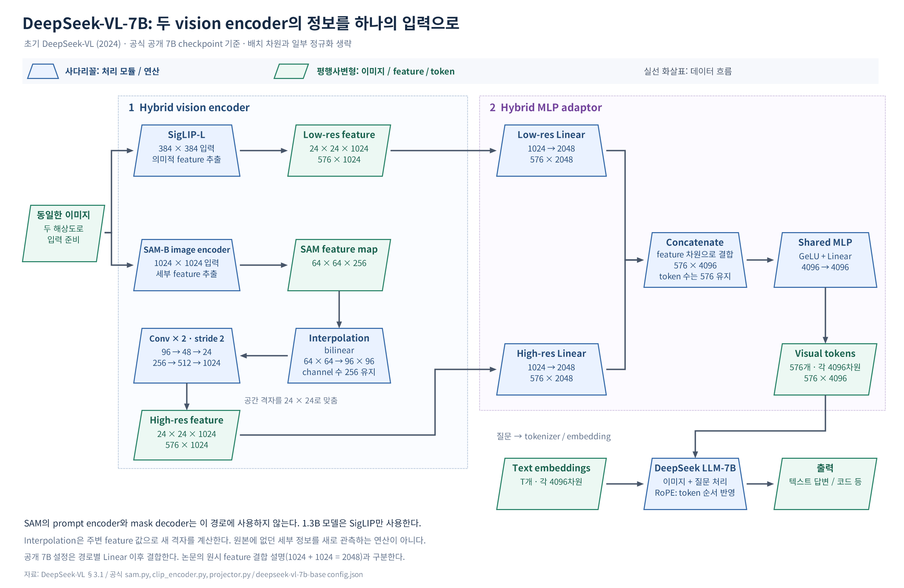

# DeepSeek-VL: 세밀한 이미지를 읽으면서 언어 능력도 유지하기

## 1. Introduction

매출 그래프와 작은 숫자, 메뉴가 함께 있는 대시보드 화면을 보고 “지난달과 비교해 무엇이 달라졌는지 설명해 줘”라고 요청한다고 해 보자. 화면의 전체 구성을 파악하는 것만으로는 부족하다. 작은 글자와 숫자를 읽고, 그래프의 변화를 해석하고, 그 결과를 질문에 맞는 문장으로 설명해야 한다.

이미지와 LLM을 연결한 모델에서도 이 과정은 쉽지 않다. 입력 이미지를 작게 줄이면 세부 정보가 사라질 수 있고, 시각 정보를 많이 전달하면 token 수와 연산량이 늘어난다. 시각 능력을 추가 학습하는 동안 기존 언어 능력이 약해지는 문제도 있다.

2024년의 DeepSeek-VL은 이 문제를 데이터, 모델 구조, 학습 전략을 함께 설계하는 방식으로 다룬다. 7B 모델에서는 SigLIP-L과 SAM-B image encoder를 결합해 고해상도 이미지를 처리하고, 학습에서는 multimodal 데이터와 text-only 데이터를 함께 사용한다. 실제 사용 사례에 맞춘 SFT도 수행한다. 여기서는 초기 DeepSeek-VL의 1.3B·7B 계열을 살펴본다. [원논문 §1](https://arxiv.org/html/2403.05525v2#S1)

## 2. Background

### Hybrid vision encoder와 SAM-B

Vision encoder는 이미지에서 계산 가능한 feature를 얻는 모듈이다. Hybrid vision encoder는 서로 다른 encoder의 특징을 결합한다는 뜻이다. DeepSeek-VL-7B에서는 이미지와 언어의 의미를 연결하는 SigLIP-L과, 고해상도 세부 정보를 얻기 위한 SAM-B image encoder를 함께 사용한다.

SAM-B는 Segment Anything의 ViT-B 기반 버전이다. DeepSeek-VL은 이 모델의 image encoder를 가져와 feature를 활용한다. 원래 SAM의 점·박스 입력을 처리하는 prompt encoder와 mask를 생성하는 mask decoder는 이 경로에 사용하지 않는다. 작은 1.3B 모델은 SigLIP 단일 encoder를 사용한다. [DeepSeek-VL §3.1·Table 4](https://arxiv.org/html/2403.05525v2#S3.SS1), [SAM 공식 구성](https://github.com/facebookresearch/segment-anything/blob/main/segment_anything/build_sam.py)

### Interpolation과 feature grid

Feature map은 위치별 벡터가 가로·세로 격자에 배치된 표현이다. Interpolation은 기존 위치의 값을 이용해 새로운 격자 위치의 값을 계산하는 연산이다. 예를 들어 한 방향에서 값 0과 10 사이에 새 위치를 만들면, 선형 interpolation으로 중간값 5를 계산할 수 있다.

Bilinear interpolation은 가로·세로 두 방향의 주변 값을 이용한다. 격자를 더 촘촘하게 만들 수 있지만, 원본에서 새로운 세부 정보를 관측하는 과정은 아니다. DeepSeek-VL은 이 연산으로 두 encoder가 만든 feature의 공간 크기를 맞추는 과정을 설계한다. [공식 sam.py](https://github.com/deepseek-ai/DeepSeek-VL/blob/main/deepseek_vl/models/sam.py)

Token 수와 feature 차원도 구분해야 한다. $N\times d$에서 $N$은 위치별 벡터의 개수, $d$는 벡터 하나의 차원이다. Feature 차원으로 concatenate하면 각 위치의 벡터가 길어지고, sequence 차원으로 concatenate하면 token 개수가 늘어난다.

### Pretraining data와 SFT data

Pretraining은 폭넓은 지식·표현·cross-modal 관계를 학습하는 데, SFT는 지시와 상황에 맞는 응답을 학습하는 데 주로 초점을 둔다. 데이터 자체가 고정된 두 종류로 나뉘는 것은 아니다. Caption이나 QA를 어느 학습 단계에 어떤 목적으로 사용하는지가 중요하다.

두 단계 모두 정답 token을 예측하는 next-token prediction과 cross-entropy loss를 사용할 수 있다. Pretraining에도 caption 같은 정답 텍스트가 있고, SFT에서도 새로운 지식을 배울 수 있다. 실제로 DeepSeek-VL은 pretraining 중에도 instruction-following을 보완하기 위해 SFT 데이터를 소량 섞는다. [원논문 §2·§3.2](https://arxiv.org/html/2403.05525v2#S2)

### Use case taxonomy

Use case taxonomy는 사용자가 모델에 시키려는 일을 계층적으로 분류한 체계다. 이미지의 글자를 읽는 작업은 Recognition, UI 이미지를 코드로 바꾸는 작업은 Conversion, 차트를 해석하는 작업은 Analysis에 넣을 수 있다.

DeepSeek-VL은 실제 사용 사례를 이 체계로 정리하고, 범주에 맞는 이미지와 prompt를 선택해 자체 SFT 데이터를 구성한다. 같은 체계는 실제 사용 상황을 평가하는 dataset의 작업 범위를 정하는 데도 활용한다. 학습과 평가가 어떤 사용 사례를 다루는지 함께 설계하는 기준인 셈이다. [원논문 §2.2·Table 3](https://arxiv.org/html/2403.05525v2#S2.SS2)

### Catastrophic forgetting과 modality warm-up

Catastrophic forgetting은 새로운 데이터를 학습하면서 기존에 수행하던 작업의 능력이 약해지는 현상이다. 같은 LLM 파라미터를 업데이트하므로 새 데이터에 적응하는 변화가 기존 작업에는 불리할 수 있다.

이 논문은 multimodal corpus와 language corpus의 복잡도·분포 차이, 두 modality 사이의 경쟁을 언어 성능 저하의 원인으로 가설화한다. Modality warm-up은 새 modality의 데이터 비중을 점진적으로 늘려 이러한 적응을 조절하는 전략이다. 여기서 바꾸는 것은 데이터 혼합 비율이다. [원논문 §3.2.2·§4.4](https://arxiv.org/html/2403.05525v2#S3.SS2.SSS2)

### Rotary Embedding

Rotary Embedding, 보통 RoPE라고 부르는 방법은 token의 순서와 상대적 거리를 attention에 반영하는 positional encoding이다. Q와 K 벡터의 성분을 둘씩 묶어 위치에 따른 각도로 회전시키면, 두 벡터의 내적에 상대적인 위치 차이가 반영된다. 실제 이미지를 회전시키는 연산이 아니라 LLM 내부의 벡터 계산이다. [RoPE 원논문 §3](https://arxiv.org/html/2104.09864v5#S3)

### Perplexity와 PPL 기반 평가

Perplexity(PPL)는 모델이 주어진 token 시퀀스를 얼마나 잘 예측하는지 나타내는 지표다. 각 token의 음의 로그 확률을 평균한 뒤 지수 함수를 적용하며, 낮을수록 해당 시퀀스에 높은 확률을 부여했다는 뜻이다. 객관식 평가에서는 같은 질문을 조건으로 각 선택지의 PPL을 계산하고, 가장 낮은 선택지를 모델의 답으로 고른다. 그 답을 정답과 비교해 정답률을 구하며, 평가 과정에서 모델 파라미터를 업데이트하지 않는다. 이 논문은 HellaSwag와 MMLU에 이러한 평가 방식을 사용한다. [DeepSeek-VL §4.2](https://arxiv.org/html/2403.05525v2#S4.SS2)

## 3. Key Idea

DeepSeek-VL은 의미 정보와 세부 시각 정보를 서로 다른 encoder에서 얻어 일정한 수의 visual token으로 연결하고, 그 정보를 배우는 동안 기존 언어 능력도 계속 학습하도록 한다.

대시보드 화면에서는 SigLIP-L이 화면 구성과 시각적 의미를 표현하고, SAM-B 경로가 고해상도의 세부 feature를 보완한다. 두 경로의 feature를 맞춰 LLM에 전달하면, 모델은 질문을 참고해 숫자를 읽고 변화를 설명하는 답변을 생성할 수 있다.

학습에서도 균형이 필요하다. 작은 연결 모듈만 학습하는 단계 이후에 LLM까지 함께 pretraining하고, 그 과정에서 text-only 데이터를 유지하며 multimodal 데이터의 도입 속도를 조절한다. 마지막에는 실제 사용자의 지시·대화 형식에 맞춰 fine-tuning한다.

## 4. Method

### 전체 구조: 하나의 이미지를 두 해상도로 처리한다



공개 7B checkpoint를 기준으로 그린 구조 개념도다. 사다리꼴은 모듈·연산, 평행사변형은 이미지·feature·token을 나타낸다. 배치 차원과 일부 정규화는 생략했다. [SVG 원본](../../assets/images/deepseek-vl/architecture.svg), [그림 출처](../../assets/images/deepseek-vl/SOURCES.md)

같은 이미지를 SigLIP-L에는 384 × 384, SAM-B image encoder에는 1024 × 1024로 입력한다. 두 경로의 결과를 24 × 24 grid로 맞춘 뒤 hybrid MLP adaptor가 결합한다. 만들어진 visual token은 질문의 text embedding과 함께 DeepSeek LLM에 들어간다.

### 1) 두 vision encoder와 feature 정렬

SigLIP-L 경로는 384 × 384 입력에서 24 × 24개의 위치별 feature를 얻는다. 각 feature는 1024차원이므로, 배치 차원을 생략하고 펼치면 다음과 같다.

$$
L\in\mathbb{R}^{576\times1024},\qquad 24\times24=576.
$$

SAM-B 경로는 1024 × 1024 입력에서 64 × 64 × 256 feature map을 얻는다. 이후 다음 연산을 거친다. 아래 feature map 표기는 높이 × 너비 × channel 순서다.

```text
64 × 64 × 256
  → bilinear interpolation
96 × 96 × 256
  → convolution, stride 2
48 × 48 × 512
  → convolution, stride 2
24 × 24 × 1024
  → reshape
576 × 1024
```

96 × 96으로 크기를 조정한 뒤 stride 2 convolution을 두 번 적용하면 SigLIP과 같은 24 × 24 grid가 된다. 최종 SAM 경로의 feature를 $H$라고 하면 $H\in\mathbb{R}^{576\times1024}$다. 두 경로의 같은 grid 순서에 있는 벡터를 결합할 준비가 된 것이다. [원논문 §3.1](https://arxiv.org/html/2403.05525v2#S3.SS1), [공식 sam.py](https://github.com/deepseek-ai/DeepSeek-VL/blob/main/deepseek_vl/models/sam.py)

### 2) Hybrid MLP adaptor: 경로별 변환과 공동 변환

공개 7B 구현은 두 encoder의 feature를 각각 다른 Linear로 변환한 뒤 feature 차원으로 합친다. 그다음 GeLU와 shared Linear를 적용한다. 서로 다른 feature 분포에 맞게 조정하는 층과, 두 정보를 함께 사용하는 층을 나눈 구조다.

배치 차원을 생략하고 bias를 $b$로 나타내면, 공식 7B 설정의 연산은 다음처럼 쓸 수 있다.

$$
H'=HW_H+b_H,\qquad L'=LW_L+b_L,
$$

$$
U=\mathrm{Concat}_{\mathrm{feature}}(H',L'),\qquad
Z=\mathrm{GeLU}(U)W_S+b_S.
$$

$W_H$와 $W_L$은 각각 $1024\times2048$인 경로별 변환 행렬이다. 따라서 $H'$와 $L'$은 각각 $576\times2048$이고, 두 결과를 옆으로 붙인 $U$는 $576\times4096$이다. $W_S$는 $4096\times4096$이며, 최종 $Z$도 $576\times4096$이다.

이 결합에서는 token 수 576이 유지된다. 고해상도 경로와 저해상도 경로의 정보를 feature 차원에 함께 담는다. 논문 §3.1의 원시 feature 결합 설명은 1024 + 1024 = 2048이며, 위 그림과 수식은 경로별 projection 이후 결합하는 공개 7B checkpoint의 차원을 따른다. [공식 projector.py](https://github.com/deepseek-ai/DeepSeek-VL/blob/main/deepseek_vl/models/projector.py), [공식 7B config.json](https://huggingface.co/deepseek-ai/deepseek-vl-7b-base/blob/main/config.json)

### 3) LLM 입력과 답변 생성

사용자 질문도 tokenizer와 embedding layer를 거쳐 LLM 입력 차원으로 표현된다. 공개 7B에서 visual token과 text embedding은 모두 4096차원이므로 하나의 입력 시퀀스 안에 배치할 수 있다. Visual token이 먼저 단어 문자열로 번역되는 과정은 없다.

이미지와 질문, 앞선 대화를 조건으로 LLM이 다음 답변 token의 확률을 계산하고, 생성한 token을 이어 붙이며 답변을 만든다. RoPE는 이 LLM의 attention에서 시퀀스 위치를 반영한다. 대시보드 설명뿐 아니라 지시에 따른 코드나 다른 텍스트도 같은 생성 경로로 출력한다. [원논문 §3.1](https://arxiv.org/html/2403.05525v2#S3.SS1)

### 4) 공통 학습 목표와 세 단계의 역할

학습을 시작할 때는 사전 학습된 vision encoder와 DeepSeek LLM의 intermediate checkpoint를 사용한다. 여기에 새 VL adaptor를 연결한 뒤 세 단계를 순서대로 진행한다.

모든 단계는 language 부분의 next-token prediction loss를 사용한다. 입력 조건을 $C$, 정답 token을 $y_t$, 그보다 앞선 정답 token들을 $y_{<t}$라고 하면 다음과 같이 나타낼 수 있다.

$$
\mathcal{L}_{\mathrm{NTP}}
=-\sum_{t\in\mathcal{T}}
\log p_{\theta}(y_t\mid C,y_{<t}).
$$

$\mathcal{T}$는 손실을 계산할 정답 위치의 집합이고, $\theta$는 현재 모델 파라미터다. 정답 token에 높은 확률을 줄수록 손실이 작아진다. 이미지 입력이 있는 경우 $C$에 시각 정보가 포함되고, text-only 데이터에서는 텍스트 문맥이 조건이 된다. 단계마다 데이터와 업데이트할 모듈을 바꾼다.

| 항목 | Stage 1: Adaptor warmup | Stage 2: Joint pretraining | Stage 3: SFT |
|---|---|---|---|
| 목적 | 시각 표현과 LLM 입력 연결 | 시각 이해 확장과 언어 능력 유지 | 사용자 지시·대화에 맞춘 응답 |
| 주요 데이터 | Image caption, document OCR | Text-only, interleaved image-text, caption, 문서·차트·OCR·코드 | 실제 use case 기반 multimodal 지시·대화, text-only 대화 |
| 예측할 정답 | 이미지 설명·문서 텍스트 | 각 작업의 정답 텍스트·다음 텍스트 | Assistant 답변과 special token |
| SigLIP-L | 고정 | 고정 | 학습 |
| SAM-B image encoder | 고정 | 고정 | 고정 |
| VL adaptor | 학습 | 학습 | 학습 |
| LLM | 고정 | 학습 | 학습 |
| 다음 단계로 전달 | 연결을 학습한 checkpoint | Base 모델 | Chat 모델 |

위의 두 encoder 구성은 7B 기준이다. 1.3B는 SigLIP만 사용한다. [원논문 §3.2·Figure 3](https://arxiv.org/html/2403.05525v2#S3.SS2)

#### Stage 1: 고정된 모델 사이의 연결 학습

Caption과 document OCR pair를 사용해 adaptor를 학습한다. 시각 정보를 받았을 때 해당 설명이나 문서 텍스트를 예측하도록 한다. LLM 가중치는 고정되어 있지만, LLM을 통과해 계산한 text loss로 adaptor를 업데이트한다.

이 단계의 결과는 시각 feature를 언어 모델에 전달하는 연결을 배운 checkpoint다. 논문은 이 작은 adaptor만 대상으로 데이터 규모를 늘렸을 때 성능이 계속 좋아지는지 실험하며, 그 한계가 다음 단계에서 LLM을 함께 학습하는 동기가 된다. [원논문 §3.2.1](https://arxiv.org/html/2403.05525v2#S3.SS2.SSS1)

#### Stage 2: Multimodal 데이터와 language 데이터의 공동 학습

Vision encoder는 고정하고 adaptor와 LLM을 함께 학습한다. 데이터는 interleaved image-text, caption, 표·차트 이해, UI·plot의 코드, scene text OCR, document OCR, text-only corpus 등으로 구성한다.

핵심은 text-only 학습을 계속 유지한다는 점이다. Multimodal 데이터만 사용한 실험에서는 시각 관련 지표가 좋아지는 동안 언어 지표가 크게 하락했다. 최종 설정은 language:multimodal을 대략 7:3으로 선택한다. 이 비율은 이 모델의 학습 설정이며, 모든 multimodal model에 적용되는 보편적인 최소 기준은 아니다.

또한 modality warm-up으로 초기에 language 데이터 비중을 높게 두고, 점진적으로 multimodal 데이터를 늘려 목표 비율에 도달하도록 한다. 처음부터 새 데이터 분포를 큰 비중으로 도입했을 때의 불안정을 줄이려는 설계다. 소량의 SFT 데이터도 섞어 instruction-following이 작은 모델의 성능 측정을 방해하지 않도록 한다. [원논문 §3.2.2·§4.4](https://arxiv.org/html/2403.05525v2#S3.SS2.SSS2)

#### Stage 3: 실제 지시와 대화에 맞춘 SFT

Stage 2의 모델에 use case taxonomy 기반 자체 데이터와 공개 multimodal instruction dataset을 사용한다. 장면 이해, OCR, 표·차트, UI-to-code 등 실제 작업의 지시·응답을 학습하며 text-only 대화도 함께 사용한다.

이 단계에서는 SigLIP-L, adaptor, LLM을 업데이트하고 SAM-B는 GPU 메모리 제약 때문에 고정한다. System·user prompt는 입력 조건으로 사용하되 loss에서 masking하고, assistant 답변과 special token을 정답으로 학습한다. 최종적으로 대화에 맞춘 Chat 모델을 얻는다.

SFT의 데이터 혼합은 Stage 2와 별도로 구성한다. Table 2에서 text-only SFT는 47.9%다. 앞의 7:3 비율을 모든 단계에 동일하게 적용하는 파이프라인으로 읽으면 안 된다. [원논문 §3.2.3·Table 2](https://arxiv.org/html/2403.05525v2#S3.SS2.SSS3)

## 5. Experiments & Results

### 무엇을 평가하고 어떻게 채점했는가?

최종 multimodal benchmark의 평가 대상은 세 단계 학습을 거친 모델이며, 1.3B와 7B를 나누어 비교한다. 입력은 이미지와 질문이고, 모델이 생성한 답변을 정답 또는 평가자와 비교한다. 학습 중 작은 모델의 진행 상태를 점검하는 평가와 최종 benchmark 평가의 절차는 구분한다.

공개 multimodal benchmark에는 MMMU·MMBench 같은 종합 이해, OCRBench, 객체 hallucination을 확인하는 POPE, MathVista 등의 문제를 사용한다. Greedy decoding으로 답변을 생성한 뒤 결과를 parsing하고 benchmark별 채점 규칙을 적용한다. MMBench·MMBench-CN은 이 논문에서 dev split을 사용했다. [원논문 §4.1](https://arxiv.org/html/2403.05525v2#S4.SS1)

Language benchmark는 이미지 없이 평가한다. HellaSwag와 MMLU에서는 각 선택지의 PPL을 계산해 가장 낮은 선택지를 고르고, 정답 선택지와 비교한다. GSM8K와 AGIEval은 greedy decoding으로 생성한 답변에서 결과를 추출해 채점한다. Pile-test는 정답 텍스트를 예측하는 비용을 byte당 bit로 나타내는 bits-per-byte를 계산하며, 낮을수록 좋다. [원논문 §4.2](https://arxiv.org/html/2403.05525v2#S4.SS2)

Stage 2의 작은 모델 실험에서는 답변을 지정 형식으로 생성하는 능력이 부족해 지표가 흔들릴 수 있었다. 그래서 선택지별 PPL로 진행 상태를 관찰하고 SFT 데이터도 소량 추가한다. 이는 최종 multimodal 평가가 모두 PPL 방식이라는 뜻이 아니다. [원논문 §3.2.2](https://arxiv.org/html/2403.05525v2#S3.SS2.SSS2)

### Multimodal 성능은?

7B에서는 Qwen-VL-Chat, CogVLM, LLaVA-Next, Yi-VL 등과 비교한다. 논문 Table 5의 6~7B 비교군에서 DeepSeek-VL은 MMBench·MMBench-CN·SEED·MathVista의 보고된 점수 중 최고 성능을 보인다. 하지만 MMMU와 MMVet에서는 더 높은 다른 모델이 있어, 모든 시각 작업에서 가장 좋다는 결과는 아니다.

1.3B에서는 MobileVLM 계열과 LLaVA-Phi 등을 비교한다. Table 6의 소형 비교군에서 MMBench 최고 성능을 보였으며, 이 중에는 더 큰 2.7B 모델도 포함된다. 1.3B 결과에는 SAM을 결합한 7B 구조를 그대로 적용해 설명하지 않아야 한다. [원논문 Table 5–6](https://arxiv.org/html/2403.05525v2#S4.T5)

### 언어 능력은 얼마나 유지되었는가?

DeepSeek-VL-7B Chat을 이미지 입력이 없는 DeepSeek-LLM-7B Chat과 비교한다. HellaSwag에서는 거의 같은 성능이고, MMLU·AGIEval은 더 높으며, MBPP는 같은 결과다. 반면 GSM8K는 낮아졌다.

따라서 공동 학습이 여러 언어 지표를 유지하거나 높이는 데 도움이 되었다고 볼 수 있지만, 모든 기존 능력을 완전히 보존했다고 해석할 수는 없다. 언어 능력의 보존을 하나의 총점으로 뭉뚱그리지 않고 작업별로 확인한 점이 중요하다. [원논문 Table 7](https://arxiv.org/html/2403.05525v2#S4.T7)

### 실제 사용 상황의 응답은?

자체 human evaluation은 use case taxonomy를 바탕으로 만든 100개의 질문을 사용한다. DeepSeek-VL-7B를 InternLM-XComposer2-VL, CogVLM, GPT-4V와 비교하며, recognition·conversion·commonsense reasoning에서는 GPT-4V에 가까운 결과를 보고한다. Logical reasoning에서는 open-source 모델들이 여전히 GPT-4V에 크게 뒤처진다. [원논문 §4.3·Figure 6](https://arxiv.org/html/2403.05525v2#S4.SS3)

별도로 99개 sample에서는 GPT-4V를 평가자로 사용한다. 같은 질문에 대한 두 모델의 답변을 보여 주고 어느 쪽이 더 좋은지 또는 동점인지 판단하게 한다. Fuyu-8B, CogVLM-17B, InternLM-XComposer2-VL 등의 응답과 비교했을 때 DeepSeek-VL이 60% 넘는 사례에서 더 좋다고 평가되었다.

이 비율은 문제의 정답률이 아니라 두 답변 사이의 선호 결과다. GPT-4V를 답변 모델로 비교한 결과와 평가자로 사용한 결과도 구분해야 한다. 이처럼 열린 응답의 품질을 평가하는 절차는 benchmark 정답 비교와 다른 종류의 근거다. [원논문 Figure 7](https://arxiv.org/html/2403.05525v2#S4.F7)

### 어떤 설계가 효과적이었는가?

Stage 1 데이터만 늘린 실험에서는 성능이 계속 향상되지 않았다. Stage 1 뒤에 바로 SFT하는 경로보다 joint pretraining인 Stage 2를 포함한 경로가 더 좋은 결과를 보였고, 세 단계를 모두 사용하는 구성이 가장 좋았다. 연결 모듈의 학습과 LLM의 multimodal pretraining을 구분해서 볼 근거다. [원논문 Table 8–9](https://arxiv.org/html/2403.05525v2#S4.T8)

Modality warm-up은 Figure 9의 고정 비율 학습과 비교해 초기 언어 성능 저하를 완화하고 두 modality의 최종 결과를 개선했다. 이는 데이터 혼합 비율뿐 아니라 도입 과정도 학습 설계의 일부임을 보여 준다. [원논문 §4.4·Figure 9](https://arxiv.org/html/2403.05525v2#S4.SS4)

Vision encoder 비교에서는 학습 비용을 줄인 설정의 training loss를 관찰하며 SAM 같은 vision-only encoder를 결합하는 효과를 살폈다. Adaptor 비교에서는 token 길이를 관리하면서 feature 차원으로 결합하고, separate·shared 변환을 섞은 hybrid MLP가 보고된 평균에서 좋은 결과를 보였다. 학습 loss 비교와 최종 benchmark 개선, 평균과 개별 지표는 각각 구분해 읽는다. [원논문 Figure 10·Table 10](https://arxiv.org/html/2403.05525v2#S4.SS4)

## 6. Discussion

### 기존 능력을 유지하면서 새로운 능력을 추가하기

가장 인상적인 부분은 시각 정보를 추가하면서도 language 학습을 계속 유지한다는 점이다. 새 modality의 데이터가 충분한지뿐 아니라, 기존 모델이 익숙한 데이터 분포를 얼마나 유지하고 새 분포를 얼마나 빠르게 도입하는지도 설계 대상으로 삼는다.

이 전략은 다른 modality나 새로운 domain을 추가 학습할 때도 검토해 볼 만하다. 다만 적절한 혼합 비율과 도입 속도는 모델·데이터·학습 예산에 따라 확인해야 한다. DeepSeek-VL에서도 수학 성능 하락이 남았으므로, 기존 능력의 보존 여부를 별도 평가하는 과정까지 함께 가져가는 것이 중요하다.

### 학습 효율도 데이터 구성과 연결된다

논문은 한 batch 안에 language·multimodal sample을 섞었을 때 처리 시간이 긴 sample을 기다리는 문제도 다룬다. Step별로 modality를 묶어 sampling하는 modality group training은 해당 실험에서 성능을 유지하면서 학습 효율을 높였다. 데이터의 전체 혼합 비율과 batch를 구성하는 방식은 서로 다른 설계 변수다. [원논문 §4.4](https://arxiv.org/html/2403.05525v2#S4.SS4)

### 적용 범위와 남은 질문

고해상도 입력을 사용해도 576개 token으로 연결하는 과정에서 모든 세부 정보가 보존된다고 보장할 수는 없다. Encoder 선택 실험 역시 모든 시각 작업에서 SAM 경로의 기여를 독립적으로 확정한 결과는 아니다. 논문은 더 큰 모델과 MoE로의 확장을 향후 방향으로 제시한다. [원논문 §5](https://arxiv.org/html/2403.05525v2#S5)

후속으로는 데이터 혼합 비율과 warm-up 속도를 함께 바꿨을 때 어떤 작업이 먼저 약해지는지, 작은 글자가 밀집한 이미지에서 token budget을 늘리면 어느 정도 개선되는지 궁금하다. 구조의 표현 용량과 학습 분포의 균형을 함께 비교해 보고 싶은 지점이다.

공개 범위도 구분할 필요가 있다. 초기 DeepSeek-VL의 코드는 MIT License이고 Base·Chat weights는 별도의 DeepSeek Model License로 공개되어 있다. 공식 저장소는 상업적 사용 지원을 명시한다. [공식 공개·라이선스 안내](https://github.com/deepseek-ai/DeepSeek-VL#5-license)

## 7. Summary

DeepSeek-VL의 구조적 차별점은 SigLIP-L의 의미적 feature와 SAM-B의 고해상도 세부 feature를 결합한 데 있다. 7B에서는 두 경로를 같은 grid로 맞추고 hybrid MLP로 연결해, 1024 × 1024 입력의 정보를 576개 visual token에 담는다. 단일 encoder의 해상도만 바꾸는 것과 구분되는 설계다.

학습에서는 adaptor warmup 이후 LLM까지 업데이트하는 joint pretraining 단계를 두고, 실제 사용 사례에 맞춘 SFT로 이어 간다. 데이터 규모를 연결 모듈에만 늘리는 접근의 한계를 살피고, 중간 pretraining 단계의 효과를 비교 실험으로 확인했다. 최종 성능은 이 구조·데이터·학습이 결합된 결과이며, 각각의 기여가 모든 작업에서 분리 검증된 것은 아니다.

여기서 얻은 핵심 인사이트는 새로운 능력을 배우는 동안 기존 능력을 유지하는 방법도 함께 설계해야 한다는 점이다. Text-only 데이터를 계속 학습하고 modality warm-up으로 vision-language 데이터의 비중을 점진적으로 늘린 전략이 그 예다. 시각 능력의 향상뿐 아니라 언어 능력의 유지와 하락까지 따로 평가해야, multimodal model이 무엇을 얻고 무엇을 잃었는지 이해할 수 있다.
